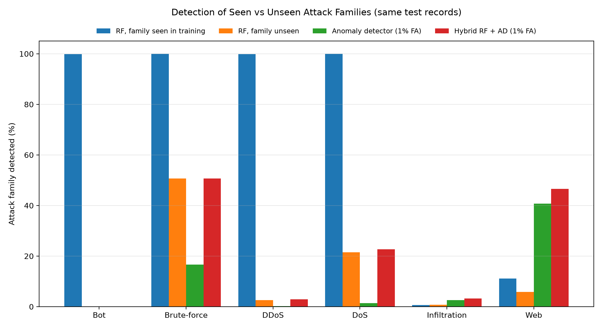

# CyberSentinel — Big Data Cybersecurity Anomaly Detection

**Hadoop HDFS · Apache Spark (PySpark MLlib) · Random Forest · Streamlit**

CyberSentinel takes the public **CSE-CIC-IDS2018** network-traffic dataset
(about 8.3 million flow records after cleaning), stores it in **Hadoop HDFS**,
cleans it and trains a **Random Forest** with **PySpark MLlib**, and labels each
network flow as **Benign (0)** or **Attack (1)**. A **Streamlit** dashboard shows
the results and can classify a CSV file that you upload.

Besides the usual accuracy figures, the project also checks:

- **Data quality** — what is wrong in each of the 10 dataset files, and why one
  file was left out.
- **Which attacks are missed** — about 98.7 % of the attacks missed by the
  reference model are a single attack type (Infiltration).
- **Brand-new attack types** — how well the model catches an attack type it
  never saw in training, and whether an anomaly detector trained only on normal
  traffic helps.

**Tech stack:** Ubuntu 24.04 · Java 17 · Hadoop 3.3.6 (HDFS) · PySpark 4.2.0 ·
Python 3.12 · pandas · matplotlib · Streamlit

> Author: Inchara M P (2023BCS0129), B.Tech CSE, IIIT Kottayam

This README is **complete on its own**: every command used in the project is
listed below in the order it was run, including the Hadoop set-up, the HDFS
upload commands, the Spark commands, and the **full source code of every file**
as copy-paste terminal commands (Step 5). A person with a fresh Ubuntu machine
can rebuild and rerun the whole project from this file alone.

---

## Contents

1. [Results at a glance](#1-results-at-a-glance)
2. [Project structure](#2-project-structure)
3. [How the pipeline fits together](#3-how-the-pipeline-fits-together)
4. [Environment used](#4-environment-used)
5. [Step-by-step reproduction](#5-step-by-step-reproduction)
   - [Step 1 — Install system packages and Java 17](#step-1--install-system-packages-and-java-17)
   - [Step 2 — Set up passwordless SSH to localhost](#step-2--set-up-passwordless-ssh-to-localhost)
   - [Step 3 — Install and configure Hadoop 3.3.6 (single node)](#step-3--install-and-configure-hadoop-336-single-node)
   - [Step 4 — Format and start HDFS](#step-4--format-and-start-hdfs)
   - [Step 5 — Create the project folder and every source file](#step-5--create-the-project-folder-and-every-source-file)
   - [Step 6 — Create the Python environment](#step-6--create-the-python-environment)
   - [Step 7 — Download the dataset](#step-7--download-the-dataset)
   - [Step 8 — Upload the raw CSVs into HDFS](#step-8--upload-the-raw-csvs-into-hdfs)
   - [Step 9 — Run the Spark pipeline scripts in order](#step-9--run-the-spark-pipeline-scripts-in-order)
   - [Step 10 — Save the results, plots and logs in HDFS too](#step-10--save-the-results-plots-and-logs-in-hdfs-too)
   - [Step 11 — Launch the Streamlit dashboard](#step-11--launch-the-streamlit-dashboard)
   - [Step 12 — Verify everything](#step-12--verify-everything)
   - [Step 13 — Stop the services](#step-13--stop-the-services)
6. [Spark commands reference](#6-spark-commands-reference)
7. [HDFS commands reference](#7-hdfs-commands-reference)
8. [Shortcut: use the shipped model without retraining](#8-shortcut-use-the-shipped-model-without-retraining)
9. [Output files](#9-output-files)
10. [Upload to GitHub and make the submission zip](#10-upload-to-github-and-make-the-submission-zip)
11. [Troubleshooting](#11-troubleshooting)
12. [Known limitations](#12-known-limitations)
13. [References](#13-references)

---

## 1. Results at a glance

Held-out test set: **1,656,020 records** (20 % split, seed 42).

| Metric | Value |
|---|---|
| Test accuracy | 97.66 % |
| Weighted precision / recall / F1 | 97.68 % / 97.66 % / 97.64 % |
| Attack precision | 98.55 % |
| Attack recall | 92.47 % |
| Attack F1-score | 95.41 % |
| False-negative rate (attacks missed) | 7.53 % |
| Training accuracy | 97.68 % |
| 3-fold CV accuracy (≈500 k-record sample of the training split) | 97.63 % |

Confusion matrix (test set): TN = 1,214,992 · FP = 5,907 · FN = 32,779 · TP = 402,342

Prediction benchmark (single VM, 3 runs per size): 1,000,000 records in
**11.48 ± 1.36 s** (≈88,000 records/s); the original single run took 8.84 s.

**Extended experiments** (Stages 2b and 8):

| Finding | Value |
|---|---|
| Rows in all 10 files / used (9 files) | 16,233,002 / 8,284,254 |
| Excluded file (`Thuesday-20-02-2018…`) | 84 columns (4 extra identifier columns); 49.0 % of all rows; all 576,191 DDoS-LOIC-HTTP records |
| Repeated header rows removed | 59 (in 3 files) |
| Invalid values (used files) | 22,954 NaN + 49,660 Infinity, only in `Flow Byts/s` and `Flow Pkts/s` |
| Files with exactly 1,048,575 rows (possible Excel row cap) | 7 of 9 |
| Missed attacks that are Infiltration (reference model trained on all families) | 98.7 % (32,398 of 32,814) |
| Detection when the family is **unseen** in training (RF, same test records as "seen") | Bot 0.0 %, DDoS 2.6 %, Infiltration 0.7 %, Web 5.8 %, DoS 21.5 %, Brute-force 50.7 % |
| Unseen Web attacks, hybrid RF + benign-only K-Means | 46.6 % (1 % FA threshold), 31.2 % (0.1 %) |
| Benign false-alarm rate: RF / hybrid 1 % / hybrid 0.1 % | 0.48 % / 1.47 % / 0.59 % |


| Dashboard demo: unseen DDoS-LOIC-HTTP flows from the excluded file (`demo_data/`) | 3 of 1,000 detected (0.3 %) |

All of these numbers are stored in `results/` and `logs/` and can be
regenerated with the steps below.

---

## 2. Project structure

```
cybersecurity_project/
├── README.md                       ← this file
├── requirements.txt                ← Python packages
├── .gitignore                      ← keeps the dataset out of Git
├── app.py                          ← Streamlit dashboard (6 pages)
├── scripts/
│   ├── common.py                   ← shared paths, Spark session, data loading & cleaning
│   ├── data_preprocessing.py       ← Stage 1: CSV → cleaned Parquet in HDFS
│   ├── dataset_statistics.py       ← Stage 2: record / class / split counts
│   ├── data_quality_audit.py       ← Stage 2b: per-file schema / header / invalid-value audit
│   ├── train_model.py              ← Stage 3: train Random Forest, save model (local + HDFS)
│   ├── evaluate_model.py           ← Stage 4: test metrics + confusion matrix
│   ├── cross_validation.py         ← Stage 5: 3-fold CV on a 500 k sample
│   ├── scalability_experiment.py   ← Stage 6: prediction time / throughput benchmark (3 runs)
│   ├── generate_plots.py           ← Stage 7: draw the figures
│   └── unseen_attack_experiment.py ← Stage 8: known vs unseen attack families (RF, anomaly, hybrid)
├── data/
│   ├── README.md                   ← how to download the dataset (not included, ~6.5 GB)
│   └── CSE_CIC_IDS2018/            ← dataset CSV files go here (Step 7)
├── models/
│   └── random_forest_model/        ← trained Spark model (created by Stage 3)
├── results/                        ← JSON / CSV results of every stage
├── plots/                          ← PNG figures
├── logs/                           ← console output of each stage (Step 9)
├── demo_data/                      ← 3 small CSVs of unseen traffic to upload in the dashboard
└── report/                         ← project report (PDF / DOCX)
```

> **Important:** the scripts locate everything relative to
> **`~/cybersecurity_project`** (your home folder). Keep the folder at exactly
> that location, or change `BASE_DIR` in `scripts/common.py` **and** in `app.py`.

---

## 3. How the pipeline fits together

```
 Ten CSE-CIC-IDS2018 CSV files (local disk: data/CSE_CIC_IDS2018/)
        │                               │
        │ hdfs dfs -put (Step 8)        │ [2b] data_quality_audit.py (all 10 files)
        ▼                               ▼
 HDFS: /cybersecurity/CSE_CIC_IDS2018/raw/      results/data_quality_*.csv/json
        │
 [1] data_preprocessing.py ── nine files: remove repeated headers, Benign→0 / other→1,
        │                     keep 78 numeric features, NaN/±Inf/null → 0
        ▼
 HDFS: /cybersecurity/CSE_CIC_IDS2018/processed/cleaned_flows  (Parquet)
        │
   ┌────┼──────────────┬───────────────┬──────────────────┬───────────────────┐
   ▼    ▼              ▼               ▼                  ▼                   ▼
 [2] dataset   [3] train_model ──► [4] evaluate    [5] cross_         [6] scalability_
  _statistics       │                 _model           validation         experiment
                    │ model saved to models/ (local) and
                    │ HDFS: /cybersecurity/CSE_CIC_IDS2018/results/random_forest_model
                    ▼
        results/*.json, *.csv ──► [7] generate_plots.py ──► plots/*.png
                                                 │
 [8] unseen_attack_experiment.py ────────────────┤ (results + plot)
                                                 ▼
                                    app.py (Streamlit dashboard)
```

Every stage that splits the data uses `randomSplit([0.8, 0.2], seed=42)`, so
training, evaluation and cross-validation all see the same partition. Stage 8
uses `randomSplit([0.7, 0.1, 0.2], seed=42)`, whose 20 % test part contains the
same rows as the 80/20 test split.

---

## 4. Environment used

| Component | Version / setting used in the experiment |
|---|---|
| Host | Oracle VirtualBox VM |
| OS | Ubuntu 24.04 LTS |
| VM resources | 8 GB RAM, 4 vCPUs, ~72 GB dynamic disk |
| Java | OpenJDK 17 |
| Python | 3.12.3 |
| Hadoop / HDFS | 3.3.6, single NameNode + DataNode on the same VM, replication = 1 |
| Spark / PySpark | 4.2.0 (installed through `pip`; no separate Spark download needed) |
| Spark mode | `local[*]` (all 4 cores), driver memory 3 GB |
| Dashboard | Streamlit |

The trained model in `models/` was saved by **Spark 4.2.0**, so keep
`pyspark==4.2.0` if you want to load it without retraining.

---

## 5. Step-by-step reproduction

All commands are for a fresh **Ubuntu 24.04** machine or VM and are run as your
normal user (not root), in a terminal (`Ctrl + Alt + T`). Lines starting with
`#` are comments. Copy one block at a time, paste it into the terminal with
`Ctrl + Shift + V`, and press Enter.

### Step 1 — Install system packages and Java 17

```bash
sudo apt update
sudo apt install -y openjdk-17-jdk python3-venv python3-pip ssh pdsh wget unzip zip git tree
java -version          # should print: openjdk version "17..."
python3 --version      # Python 3.12.x
```

### Step 2 — Set up passwordless SSH to localhost

Hadoop's start scripts log in to `localhost` over SSH.

```bash
ssh-keygen -t rsa -P "" -f ~/.ssh/id_rsa       # press Enter if asked to overwrite
cat ~/.ssh/id_rsa.pub >> ~/.ssh/authorized_keys
chmod 600 ~/.ssh/authorized_keys
ssh localhost exit                              # type "yes" the first time; must not ask for a password
```

### Step 3 — Install and configure Hadoop 3.3.6 (single node)

**3a. Download and unpack**

```bash
cd ~
wget https://archive.apache.org/dist/hadoop/common/hadoop-3.3.6/hadoop-3.3.6.tar.gz
tar -xzf hadoop-3.3.6.tar.gz
mv hadoop-3.3.6 ~/hadoop
ls ~/hadoop            # bin  etc  include  lib  libexec  sbin  share ...
```

**3b. Environment variables** — append to `~/.bashrc`:

```bash
cat >> ~/.bashrc <<'EOF'

# ---- Hadoop / Java ----
export JAVA_HOME=/usr/lib/jvm/java-17-openjdk-amd64
export HADOOP_HOME=$HOME/hadoop
export HADOOP_CONF_DIR=$HADOOP_HOME/etc/hadoop
export PATH=$PATH:$HADOOP_HOME/bin:$HADOOP_HOME/sbin
export PDSH_RCMD_TYPE=ssh
EOF
source ~/.bashrc
hadoop version         # Hadoop 3.3.6
```

**3c. Tell Hadoop where Java is**

```bash
echo 'export JAVA_HOME=/usr/lib/jvm/java-17-openjdk-amd64' >> $HADOOP_HOME/etc/hadoop/hadoop-env.sh
```

**3d. `core-site.xml`** — sets the HDFS address the scripts use (`hdfs://localhost:9000`):

```bash
cat > $HADOOP_HOME/etc/hadoop/core-site.xml <<'EOF'
<?xml version="1.0" encoding="UTF-8"?>
<configuration>
  <property>
    <name>fs.defaultFS</name>
    <value>hdfs://localhost:9000</value>
  </property>
</configuration>
EOF
```

**3e. `hdfs-site.xml`** — one copy of each block (single machine) and fixed storage folders:

```bash
mkdir -p ~/hadoop_data/namenode ~/hadoop_data/datanode
cat > $HADOOP_HOME/etc/hadoop/hdfs-site.xml <<EOF
<?xml version="1.0" encoding="UTF-8"?>
<configuration>
  <property>
    <name>dfs.replication</name>
    <value>1</value>
  </property>
  <property>
    <name>dfs.namenode.name.dir</name>
    <value>file://$HOME/hadoop_data/namenode</value>
  </property>
  <property>
    <name>dfs.datanode.data.dir</name>
    <value>file://$HOME/hadoop_data/datanode</value>
  </property>
</configuration>
EOF
```

(This block intentionally uses `<<EOF` without quotes so that `$HOME` is
replaced by your real home folder.)

### Step 4 — Format and start HDFS

```bash
hdfs namenode -format          # ONLY the first time — reformatting erases HDFS
start-dfs.sh
jps                            # must list: NameNode, DataNode, SecondaryNameNode
hdfs dfsadmin -report | head -20     # "Live datanodes (1)"
hdfs dfs -mkdir -p /cybersecurity/CSE_CIC_IDS2018
hdfs dfs -ls /cybersecurity
```

The NameNode web UI is at <http://localhost:9870> (menu **Utilities → Browse
the file system** shows the HDFS folders).

> After every VM reboot, run `start-dfs.sh` again before using the project.
> Stop HDFS cleanly with `stop-dfs.sh`.

### Step 5 — Create the project folder and every source file

**Option A — clone the repository** (quickest):

```bash
cd ~
git clone https://github.com/idsaturn07/cybersentinel.git cybersecurity_project
ls ~/cybersecurity_project
```

**Option B — create every file by pasting** (no download needed). First create
the folders:

```bash
mkdir -p ~/cybersecurity_project/{scripts,data/CSE_CIC_IDS2018,models,results,plots,logs,report,demo_data}
cd ~/cybersecurity_project
```

Then paste each block below **one at a time**. Each block is a single command:
`cat > FILE <<'PYEOF' … PYEOF` writes everything between the two `PYEOF` lines
into `FILE`. Copy the whole block, from `cat` down to and including the last
`PYEOF` line.

**5.1 `requirements.txt`** — Python packages (9 lines)

````bash
cat > ~/cybersecurity_project/requirements.txt <<'PYEOF'
# Python packages for CyberSentinel
# Tested combination: Python 3.12, Java 17, Hadoop 3.3.6.
# pyspark must match the Spark version that saved the model (4.2.0).
pyspark==4.2.0
pandas>=2.0,<3.0
numpy>=1.26
matplotlib>=3.8
streamlit>=1.36
pyarrow>=14.0
PYEOF
````

**5.2 `.gitignore`** — files Git should ignore (the dataset) (3 lines)

````bash
cat > ~/cybersecurity_project/.gitignore <<'PYEOF'
data/CSE_CIC_IDS2018/*.csv
__pycache__/
*.pyc
PYEOF
````

**5.3 `scripts/common.py`** — shared settings, Spark session, CSV loading and cleaning (154 lines)

````bash
cat > ~/cybersecurity_project/scripts/common.py <<'PYEOF'
from pathlib import Path

from pyspark.sql import SparkSession
from pyspark.sql import functions as F
from pyspark.sql.types import NumericType


# Project directories
BASE_DIR = Path.home() / "cybersecurity_project"
DATA_DIR = BASE_DIR / "data" / "CSE_CIC_IDS2018"
RESULTS_DIR = BASE_DIR / "results"
MODELS_DIR = BASE_DIR / "models"
PLOTS_DIR = BASE_DIR / "plots"

# Hadoop/HDFS configuration
HDFS_BASE = "hdfs://localhost:9000/cybersecurity/CSE_CIC_IDS2018"
HDFS_PROCESSED = f"{HDFS_BASE}/processed/cleaned_flows"
HDFS_MODEL = f"{HDFS_BASE}/results/random_forest_model"

# Use the same nine schema-consistent files as the experiment.
# The large Tuesday file is excluded because its header/schema
# did not match the other processed CSV files.
GOOD_FILES = [
    "Friday-02-03-2018_TrafficForML_CICFlowMeter.csv",
    "Friday-16-02-2018_TrafficForML_CICFlowMeter.csv",
    "Friday-23-02-2018_TrafficForML_CICFlowMeter.csv",
    "Thursday-01-03-2018_TrafficForML_CICFlowMeter.csv",
    "Thursday-15-02-2018_TrafficForML_CICFlowMeter.csv",
    "Thursday-22-02-2018_TrafficForML_CICFlowMeter.csv",
    "Wednesday-14-02-2018_TrafficForML_CICFlowMeter.csv",
    "Wednesday-21-02-2018_TrafficForML_CICFlowMeter.csv",
    "Wednesday-28-02-2018_TrafficForML_CICFlowMeter.csv",
]


def create_spark(app_name):
    """Create a local Spark session configured to access HDFS."""
    spark = (
        SparkSession.builder
        .appName(app_name)
        .master("local[*]")
        # The default 1 GB driver heap is too small for model training here.
        .config("spark.driver.memory", "3g")
        .config(
            "spark.hadoop.fs.defaultFS",
            "hdfs://localhost:9000"
        )
        .getOrCreate()
    )

    spark.sparkContext.setLogLevel("WARN")
    return spark


def quote_column(name):
    """Safely reference feature names containing spaces or symbols."""
    return F.col("`" + name.replace("`", "``") + "`")


def load_and_clean_local_dataset(spark, keep_attack_type=False):
    """
    Load the nine schema-consistent CSV files, remove repeated headers,
    convert labels to binary classes, and clean invalid numeric values.

    If keep_attack_type is True, the original label text (for example
    "DoS attacks-Hulk") is also kept in an 'attack_type' column. It is used
    only for analysis, never as a model input.

    Returns:
        cleaned_df: numeric features plus the binary 'label' column
        feature_columns: feature names in their original column order
    """
    local_files = [DATA_DIR / name for name in GOOD_FILES]

    missing = [str(path) for path in local_files if not path.is_file()]
    if missing:
        raise FileNotFoundError(
            "Required dataset files are missing:\n" + "\n".join(missing)
        )

    raw = (
        spark.read
        .option("header", "true")
        .option("inferSchema", "true")
        .option("mode", "PERMISSIVE")
        # file:// is required: fs.defaultFS points at HDFS, so a bare
        # path would otherwise be looked up inside HDFS, not on disk.
        .csv([path.as_uri() for path in local_files])
    )

    if "Label" not in raw.columns:
        raise ValueError(
            "The CSV files must contain a 'Label' column."
        )

    # Remove the repeated header rows found inside some CSV files.
    raw = raw.filter(
        F.trim(F.col("Label")) != F.lit("Label")
    )

    # Keep numeric feature columns in the dataset's original order.
    feature_columns = [
        field.name
        for field in raw.schema.fields
        if isinstance(field.dataType, NumericType)
        and field.name not in ("Label", "label")
    ]

    if not feature_columns:
        raise ValueError(
            "No numeric feature columns were found."
        )

    # Keep the original label text before 'label' is created: Spark column
    # names are case-insensitive, so 'label' replaces the text 'Label' column.
    if keep_attack_type:
        raw = raw.withColumn("attack_type", F.trim(F.col("Label")))

    # Benign = 0; all other attack labels = 1.
    cleaned = raw.withColumn(
        "label",
        F.when(
            F.trim(F.col("Label")) == F.lit("Benign"),
            F.lit(0.0)
        ).otherwise(F.lit(1.0))
    )

    # Replace missing, NaN, and infinite numeric values with zero.
    # Cast features to double so VectorAssembler receives numeric values.
    for name in feature_columns:
        value = quote_column(name).cast("double")

        invalid = (
            value.isNull()
            | F.isnan(value)
            | (value == float("inf"))
            | (value == float("-inf"))
        )

        cleaned = cleaned.withColumn(
            name,
            F.when(invalid, F.lit(0.0)).otherwise(value)
        )

    # The model uses only numeric features and the binary target.
    extra = [F.col("attack_type")] if keep_attack_type else []

    cleaned = cleaned.select(
        *[quote_column(name) for name in feature_columns],
        F.col("label"),
        *extra
    )

    return cleaned, feature_columns
PYEOF
````

**5.4 `scripts/data_preprocessing.py`** — Stage 1 (54 lines)

````bash
cat > ~/cybersecurity_project/scripts/data_preprocessing.py <<'PYEOF'
import json

from common import (
    BASE_DIR,
    RESULTS_DIR,
    HDFS_PROCESSED,
    create_spark,
    load_and_clean_local_dataset,
)


def main():
    RESULTS_DIR.mkdir(parents=True, exist_ok=True)

    spark = create_spark("CyberSentinel-Data-Preprocessing")

    try:
        print("Loading and cleaning CSE-CIC-IDS2018 files...")

        cleaned_df, feature_columns = load_and_clean_local_dataset(
            spark
        )

        print("Numeric feature columns:", len(feature_columns))

        # Store the cleaned dataset in HDFS as Parquet.
        print("Writing cleaned dataset to HDFS...")
        (
            cleaned_df.write
            .mode("overwrite")
            .parquet(HDFS_PROCESSED)
        )

        # Preserve the exact input-feature order.
        feature_file = RESULTS_DIR / "feature_columns.json"

        with open(feature_file, "w", encoding="utf-8") as f:
            json.dump(feature_columns, f, indent=2)

        # Count the processed rows for the run summary.
        row_count = cleaned_df.count()

        print("\nPreprocessing completed successfully.")
        print("Cleaned records:", f"{row_count:,}")
        print("Feature columns:", len(feature_columns))
        print("HDFS output:", HDFS_PROCESSED)
        print("Feature configuration:", feature_file)

    finally:
        spark.stop()


if __name__ == "__main__":
    main()
PYEOF
````

**5.5 `scripts/dataset_statistics.py`** — Stage 2 (98 lines)

````bash
cat > ~/cybersecurity_project/scripts/dataset_statistics.py <<'PYEOF'
"""
Reproduce the dataset record counts reported in the project report:

    - rows read from the nine selected CSV files
    - repeated header rows removed
    - cleaned working records
    - Benign / Attack class counts
    - 80/20 training and test partition sizes (seed 42)

Run after data_preprocessing.py. Output: results/dataset_statistics.json
"""

import json

from pyspark.sql import functions as F

from common import (
    DATA_DIR,
    GOOD_FILES,
    RESULTS_DIR,
    HDFS_PROCESSED,
    create_spark,
)


def main():
    RESULTS_DIR.mkdir(parents=True, exist_ok=True)

    spark = create_spark("CyberSentinel-Dataset-Statistics")

    try:
        local_files = [DATA_DIR / name for name in GOOD_FILES]

        missing = [str(p) for p in local_files if not p.is_file()]
        if missing:
            raise FileNotFoundError(
                "Required dataset files are missing:\n" + "\n".join(missing)
            )

        # Raw counts: read the same files the same way as preprocessing.
        raw = (
            spark.read
            .option("header", "true")
            .option("inferSchema", "true")
            .option("mode", "PERMISSIVE")
            .csv([p.as_uri() for p in local_files])
        )

        raw_rows = raw.count()
        header_rows = raw.filter(
            F.trim(F.col("Label")) == F.lit("Label")
        ).count()

        # Cleaned counts: read the processed Parquet stored in HDFS.
        cleaned = spark.read.parquet(HDFS_PROCESSED)
        cleaned_rows = cleaned.count()

        class_counts = {
            int(row["label"]): int(row["count"])
            for row in cleaned.groupBy("label").count().collect()
        }
        benign = class_counts.get(0, 0)
        attack = class_counts.get(1, 0)

        # Same split call as train_model.py / evaluate_model.py.
        train, test = cleaned.randomSplit([0.8, 0.2], seed=42)
        train_rows = train.count()
        test_rows = test.count()

        stats = {
            "selected_files": len(GOOD_FILES),
            "raw_rows_before_header_filter": raw_rows,
            "repeated_header_rows_removed": header_rows,
            "cleaned_rows": cleaned_rows,
            "benign_rows": benign,
            "attack_rows": attack,
            "benign_percent": round(100 * benign / cleaned_rows, 2),
            "attack_percent": round(100 * attack / cleaned_rows, 2),
            "training_rows": train_rows,
            "test_rows": test_rows,
        }

        output_path = RESULTS_DIR / "dataset_statistics.json"
        with open(output_path, "w", encoding="utf-8") as f:
            json.dump(stats, f, indent=2)

        print("\nDataset statistics")
        for key, value in stats.items():
            shown = f"{value:,}" if isinstance(value, int) else value
            print(f"  {key}: {shown}")
        print("Saved:", output_path)

    finally:
        spark.stop()


if __name__ == "__main__":
    main()
PYEOF
````

**5.6 `scripts/data_quality_audit.py`** — Stage 2b (221 lines)

````bash
cat > ~/cybersecurity_project/scripts/data_quality_audit.py <<'PYEOF'
"""
Data-quality audit of the CSE-CIC-IDS2018 processed CSV files.

For every CSV file in data/CSE_CIC_IDS2018/ (all ten, including the one that
is excluded from modelling) this records:

    - file size and number of columns in the header
    - whether the header matches the shared schema of the nine model files
      (same column names in the same order), and which columns differ
    - data rows and repeated header rows (rows whose Label is "Label")
    - missing, NaN and +/-Infinity values in the 78 model feature columns
    - the traffic labels present in the file and their counts
    - the inclusion / exclusion decision used by the pipeline

Every file is read on its own with its own header, so the excluded file can
be audited even though its schema differs. Values are read as text (no type
inference) so that "NaN" and "Infinity" strings are counted exactly as they
appear in the files.

Run after data_preprocessing.py (needs results/feature_columns.json).

Outputs:
    results/data_quality_audit.csv           one row per file
    results/invalid_values_by_column.csv     invalid counts per feature (included files)
    results/labels_by_file.csv               label counts per file
    results/data_quality_summary.json        totals
"""

import csv
import json

import pandas as pd
from pyspark.sql import functions as F

from common import DATA_DIR, GOOD_FILES, RESULTS_DIR, create_spark

NAN_STRINGS = ["NaN", "nan"]
INF_STRINGS = ["Infinity", "-Infinity", "inf", "-inf", "Inf", "-Inf"]


def read_header(path):
    with open(path, "r", encoding="utf-8", errors="replace", newline="") as f:
        return [c.strip().lstrip("") for c in next(csv.reader(f))]


def qcol(name):
    return F.col("`" + name.replace("`", "``") + "`")


def main():
    RESULTS_DIR.mkdir(parents=True, exist_ok=True)

    with open(RESULTS_DIR / "feature_columns.json", "r", encoding="utf-8") as f:
        feature_columns = json.load(f)

    files = sorted(DATA_DIR.glob("*.csv"))
    if not files:
        raise FileNotFoundError(f"No CSV files found in {DATA_DIR}")

    # Reference schema = header of the first included file.
    reference = read_header(DATA_DIR / GOOD_FILES[0])

    spark = create_spark("CyberSentinel-Data-Quality-Audit")

    audit_rows, label_rows, column_rows = [], [], []

    try:
        for path in files:
            name = path.name
            header = read_header(path)
            included = name in GOOD_FILES
            extra = [c for c in header if c not in reference]
            missing = [c for c in reference if c not in header]
            same_schema = header == reference

            print(f"\nAuditing {name} ({path.stat().st_size / 1e9:.2f} GB, "
                  f"{len(header)} columns)...", flush=True)

            df = (
                spark.read
                .option("header", "true")
                .option("inferSchema", "false")
                .option("mode", "PERMISSIVE")
                .csv(path.as_uri())
            )

            if "Label" in df.columns:
                is_header_row = F.trim(F.col("Label")) == F.lit("Label")
            else:
                is_header_row = F.lit(False)

            present = [c for c in feature_columns if c in df.columns]

            # One pass: row counts plus missing / NaN / Infinity per feature.
            exprs = [
                F.count(F.lit(1)).alias("rows_read"),
                F.sum(is_header_row.cast("long")).alias("header_rows"),
            ]
            for i, c in enumerate(present):
                v = F.trim(qcol(c))
                exprs += [
                    F.sum((v.isNull() | (v == "")).cast("long")).alias(f"m{i}"),
                    F.sum(v.isin(*NAN_STRINGS).cast("long")).alias(f"n{i}"),
                    F.sum(v.isin(*INF_STRINGS).cast("long")).alias(f"i{i}"),
                ]
            agg = df.agg(*exprs).collect()[0]

            rows_read = int(agg["rows_read"])
            header_rows = int(agg["header_rows"] or 0)

            missing_total = nan_total = inf_total = 0
            for i, c in enumerate(present):
                m, n, inf = (int(agg[f"m{i}"] or 0), int(agg[f"n{i}"] or 0),
                             int(agg[f"i{i}"] or 0))
                missing_total += m
                nan_total += n
                inf_total += inf
                if included and (m or n or inf):
                    column_rows.append({"file": name, "feature": c,
                                        "missing": m, "nan": n, "infinity": inf})

            # Labels present in the file (header rows excluded).
            n_labels = 0
            if "Label" in df.columns:
                for r in (df.filter(~is_header_row)
                          .groupBy(F.trim(F.col("Label")).alias("label"))
                          .count().collect()):
                    label_rows.append({"file": name, "label": r["label"],
                                       "count": int(r["count"])})
                    n_labels += 1

            if included:
                decision = "Included"
                reason = "Matches the shared 80-column schema"
            else:
                decision = "Excluded"
                reason = ("Header does not match the shared schema"
                          if not same_schema else "Not in GOOD_FILES list")

            audit_rows.append({
                "file": name,
                "size_gb": round(path.stat().st_size / 1e9, 3),
                "header_columns": len(header),
                "matches_shared_schema": same_schema,
                "extra_columns": "; ".join(extra),
                "missing_columns": "; ".join(missing),
                "data_rows_read": rows_read,
                "repeated_header_rows": header_rows,
                "rows_after_header_removal": rows_read - header_rows,
                "missing_values": missing_total,
                "nan_values": nan_total,
                "infinity_values": inf_total,
                "distinct_labels": n_labels,
                "decision": decision,
                "reason": reason,
            })
            print({k: audit_rows[-1][k] for k in (
                "header_columns", "matches_shared_schema", "data_rows_read",
                "repeated_header_rows", "nan_values", "infinity_values",
                "decision")}, flush=True)

        audit = pd.DataFrame(audit_rows)
        labels = pd.DataFrame(label_rows)
        columns = pd.DataFrame(column_rows,
                               columns=["file", "feature", "missing", "nan", "infinity"])

        audit.to_csv(RESULTS_DIR / "data_quality_audit.csv", index=False)
        labels.to_csv(RESULTS_DIR / "labels_by_file.csv", index=False)

        by_feature = (columns.groupby("feature")[["missing", "nan", "infinity"]]
                      .sum().reset_index())
        by_feature["total_invalid"] = by_feature[["missing", "nan", "infinity"]].sum(axis=1)
        by_feature = by_feature.sort_values("total_invalid", ascending=False)
        by_feature.to_csv(RESULTS_DIR / "invalid_values_by_column.csv", index=False)

        inc = audit[audit["decision"] == "Included"]
        summary = {
            "files_audited": int(len(audit)),
            "files_included": int(len(inc)),
            "files_excluded": audit.loc[audit["decision"] == "Excluded", "file"].tolist(),
            "all_files_rows_read": int(audit["data_rows_read"].sum()),
            "included_rows_read": int(inc["data_rows_read"].sum()),
            "included_repeated_header_rows": int(inc["repeated_header_rows"].sum()),
            "included_rows_after_header_removal": int(inc["rows_after_header_removal"].sum()),
            "included_missing_values": int(inc["missing_values"].sum()),
            "included_nan_values": int(inc["nan_values"].sum()),
            "included_infinity_values": int(inc["infinity_values"].sum()),
            "features_with_invalid_values": by_feature.loc[
                by_feature["total_invalid"] > 0, "feature"].tolist(),
            "shared_schema_columns": len(reference),
        }
        with open(RESULTS_DIR / "data_quality_summary.json", "w", encoding="utf-8") as f:
            json.dump(summary, f, indent=2)

        pd.set_option("display.width", 200)
        pd.set_option("display.max_colwidth", 60)
        print("\n=== DATA-QUALITY AUDIT (per file) ===")
        print(audit[["file", "size_gb", "header_columns", "matches_shared_schema",
                     "data_rows_read", "repeated_header_rows", "nan_values",
                     "infinity_values", "decision"]].to_string(index=False))
        excluded = audit[audit["decision"] == "Excluded"]
        for _, r in excluded.iterrows():
            print(f"\nExcluded: {r['file']}")
            print(f"  extra columns  : {r['extra_columns'] or '-'}")
            print(f"  missing columns: {r['missing_columns'] or '-'}")
        print("\n=== Features with invalid values (included files) ===")
        print(by_feature[by_feature["total_invalid"] > 0].to_string(index=False))
        print("\n=== Labels by file ===")
        if not labels.empty:
            print(labels.sort_values(["file", "count"], ascending=[True, False])
                  .to_string(index=False))
        print("\n=== SUMMARY ===")
        print(json.dumps(summary, indent=2))
        print("\nSaved to", RESULTS_DIR)

    finally:
        spark.stop()


if __name__ == "__main__":
    main()
PYEOF
````

**5.7 `scripts/train_model.py`** — Stage 3 (118 lines)

````bash
cat > ~/cybersecurity_project/scripts/train_model.py <<'PYEOF'
import json

import pandas as pd
from pyspark.ml.classification import RandomForestClassifier
from pyspark.ml.feature import VectorAssembler

from common import (
    RESULTS_DIR,
    MODELS_DIR,
    HDFS_PROCESSED,
    HDFS_MODEL,
    create_spark,
)


def main():
    RESULTS_DIR.mkdir(parents=True, exist_ok=True)
    MODELS_DIR.mkdir(parents=True, exist_ok=True)

    feature_file = RESULTS_DIR / "feature_columns.json"

    if not feature_file.exists():
        raise FileNotFoundError(
            f"Feature configuration not found: {feature_file}. "
            "Run data_preprocessing.py first."
        )

    with open(feature_file, "r", encoding="utf-8") as f:
        feature_columns = json.load(f)

    spark = create_spark("CyberSentinel-RandomForest-Training")

    try:
        print("Loading cleaned dataset from HDFS...")
        cleaned_df = spark.read.parquet(HDFS_PROCESSED)

        assembler = VectorAssembler(
            inputCols=feature_columns,
            outputCol="features"
        )

        data = assembler.transform(cleaned_df).select(
            "features", "label"
        )

        train, test = data.randomSplit(
            [0.8, 0.2],
            seed=42
        )

        print("Training Random Forest...")
        print("Trees: 20 | Maximum depth: 10")

        rf = RandomForestClassifier(
            featuresCol="features",
            labelCol="label",
            numTrees=20,
            maxDepth=10,
            seed=42
        )

        model = rf.fit(train)

        # Save the model locally for the GitHub project.
        local_model_path = MODELS_DIR / "random_forest_model"

        model.write().overwrite().save(local_model_path.as_uri())

        # Save a copy in HDFS.
        model.write().overwrite().save(HDFS_MODEL)

        # Save feature importances.
        importance_df = pd.DataFrame({
            "Feature": feature_columns,
            "Importance": model.featureImportances.toArray()
        }).sort_values(
            "Importance",
            ascending=False
        )

        importance_df.to_csv(
            RESULTS_DIR / "feature_importance.csv",
            index=False
        )

        # Record the configuration used for this training run.
        summary = {
            "algorithm": "Random Forest",
            "features": len(feature_columns),
            "num_trees": 20,
            "max_depth": 10,
            "random_seed": 42,
            "split": {
                "training_fraction": 0.8,
                "test_fraction": 0.2
            },
            "local_model_path": str(local_model_path),
            "hdfs_model_path": HDFS_MODEL
        }

        with open(
            RESULTS_DIR / "training_summary.json",
            "w",
            encoding="utf-8"
        ) as f:
            json.dump(summary, f, indent=2)

        print("\nTraining and model saving completed.")
        print("Local model:", local_model_path)
        print("HDFS model:", HDFS_MODEL)
        print("Feature importances saved.")

    finally:
        spark.stop()


if __name__ == "__main__":
    main()
PYEOF
````

**5.8 `scripts/evaluate_model.py`** — Stage 4 (178 lines)

````bash
cat > ~/cybersecurity_project/scripts/evaluate_model.py <<'PYEOF'
import json

from pyspark import StorageLevel
from pyspark.ml.classification import RandomForestClassificationModel
from pyspark.ml.evaluation import MulticlassClassificationEvaluator
from pyspark.ml.feature import VectorAssembler

from common import (
    RESULTS_DIR,
    MODELS_DIR,
    HDFS_PROCESSED,
    HDFS_MODEL,
    create_spark,
)


def main():
    RESULTS_DIR.mkdir(parents=True, exist_ok=True)

    feature_file = RESULTS_DIR / "feature_columns.json"

    with open(feature_file, "r", encoding="utf-8") as f:
        feature_columns = json.load(f)

    spark = create_spark("CyberSentinel-Model-Evaluation")

    try:
        local_model_path = MODELS_DIR / "random_forest_model"

        if local_model_path.exists():
            print("Loading model from local models folder...")
            model = RandomForestClassificationModel.load(
                local_model_path.as_uri()
            )
        else:
            print("Loading model from HDFS...")
            model = RandomForestClassificationModel.load(HDFS_MODEL)

        cleaned_df = spark.read.parquet(HDFS_PROCESSED)

        assembler = VectorAssembler(
            inputCols=feature_columns,
            outputCol="features"
        )

        data = assembler.transform(cleaned_df).select(
            "features", "label"
        )

        train, test = data.randomSplit(
            [0.8, 0.2],
            seed=42
        )

        print("Generating test predictions...")
        predictions = model.transform(test).persist(
            StorageLevel.DISK_ONLY
        )

        evaluator = MulticlassClassificationEvaluator(
            labelCol="label",
            predictionCol="prediction"
        )

        accuracy = evaluator.setMetricName(
            "accuracy"
        ).evaluate(predictions)

        precision = evaluator.setMetricName(
            "weightedPrecision"
        ).evaluate(predictions)

        recall = evaluator.setMetricName(
            "weightedRecall"
        ).evaluate(predictions)

        f1 = evaluator.setMetricName(
            "f1"
        ).evaluate(predictions)

        counts = {
            (0, 0): 0,
            (0, 1): 0,
            (1, 0): 0,
            (1, 1): 0
        }

        for row in (
            predictions
            .groupBy("label", "prediction")
            .count()
            .collect()
        ):
            key = (int(row["label"]), int(row["prediction"]))
            counts[key] = int(row["count"])

        tn = counts[(0, 0)]
        fp = counts[(0, 1)]
        fn = counts[(1, 0)]
        tp = counts[(1, 1)]

        attack_precision = tp / (tp + fp) if tp + fp else 0.0
        attack_recall = tp / (tp + fn) if tp + fn else 0.0

        attack_f1 = (
            2 * attack_precision * attack_recall
            / (attack_precision + attack_recall)
            if attack_precision + attack_recall
            else 0.0
        )

        false_negative_rate = (
            fn / (fn + tp)
            if fn + tp
            else 0.0
        )

        # Calculate training accuracy for comparison.
        print("Checking training accuracy...")
        train_predictions = model.transform(train)

        training_accuracy = MulticlassClassificationEvaluator(
            labelCol="label",
            predictionCol="prediction",
            metricName="accuracy"
        ).evaluate(train_predictions)

        # Preserve the previously recorded CV result, if available.
        metrics_path = RESULTS_DIR / "project_metrics.json"

        if metrics_path.exists():
            with open(metrics_path, "r", encoding="utf-8") as f:
                metrics = json.load(f)
        else:
            metrics = {}

        metrics.update({
            "training_accuracy": float(training_accuracy),
            "test_accuracy": float(accuracy),
            "weighted_precision": float(precision),
            "weighted_recall": float(recall),
            "weighted_f1": float(f1),
            "attack_precision": float(attack_precision),
            "attack_recall": float(attack_recall),
            "attack_f1": float(attack_f1),
            "false_negative_rate": float(false_negative_rate),
            "confusion_matrix": {
                "TN": tn,
                "FP": fp,
                "FN": fn,
                "TP": tp
            }
        })

        with open(metrics_path, "w", encoding="utf-8") as f:
            json.dump(metrics, f, indent=2)

        print("\nEvaluation completed.")
        print(f"Training accuracy: {training_accuracy:.4%}")
        print(f"Test accuracy: {accuracy:.4%}")
        print(f"Weighted precision: {precision:.4%}")
        print(f"Weighted recall: {recall:.4%}")
        print(f"Weighted F1-score: {f1:.4%}")
        print(f"Attack precision: {attack_precision:.4%}")
        print(f"Attack recall: {attack_recall:.4%}")
        print(f"Attack F1-score: {attack_f1:.4%}")
        print(f"False-negative rate: {false_negative_rate:.4%}")
        print("Confusion matrix counts:", metrics["confusion_matrix"])
        print("Saved metrics:", metrics_path)

        predictions.unpersist()

    finally:
        spark.stop()


if __name__ == "__main__":
    main()
PYEOF
````

**5.9 `scripts/cross_validation.py`** — Stage 5 (146 lines)

````bash
cat > ~/cybersecurity_project/scripts/cross_validation.py <<'PYEOF'
import json

from pyspark.ml.classification import RandomForestClassifier
from pyspark.ml.evaluation import MulticlassClassificationEvaluator
from pyspark.ml.feature import VectorAssembler
from pyspark.ml.tuning import CrossValidator, ParamGridBuilder

from common import (
    RESULTS_DIR,
    HDFS_PROCESSED,
    create_spark,
)


def main():
    RESULTS_DIR.mkdir(parents=True, exist_ok=True)

    feature_file = RESULTS_DIR / "feature_columns.json"

    with open(feature_file, "r", encoding="utf-8") as f:
        feature_columns = json.load(f)

    spark = create_spark("CyberSentinel-CrossValidation")

    try:
        print("Loading cleaned data from HDFS...")

        cleaned_df = spark.read.parquet(HDFS_PROCESSED)

        assembler = VectorAssembler(
            inputCols=feature_columns,
            outputCol="features"
        )

        data = assembler.transform(cleaned_df).select(
            "features", "label"
        )

        train, test = data.randomSplit(
            [0.8, 0.2],
            seed=42
        )

        training_count = train.count()

        if training_count == 0:
            raise ValueError("The training split contains no records.")

        # Match the approximately 500,000-record CV sample
        # used in the original experiment.
        fraction = min(1.0, 500000.0 / training_count)

        cv_data = train.sample(
            withReplacement=False,
            fraction=fraction,
            seed=42
        )

        sample_count = cv_data.count()

        print("Cross-validation sample:", f"{sample_count:,}")
        print("Number of folds: 3")

        rf = RandomForestClassifier(
            featuresCol="features",
            labelCol="label",
            numTrees=20,
            maxDepth=10,
            seed=42
        )

        evaluator = MulticlassClassificationEvaluator(
            labelCol="label",
            predictionCol="prediction",
            metricName="accuracy"
        )

        # An empty parameter grid evaluates the configured model
        # without searching additional hyperparameter combinations.
        param_grid = ParamGridBuilder().build()

        cv = CrossValidator(
            estimator=rf,
            estimatorParamMaps=param_grid,
            evaluator=evaluator,
            numFolds=3,
            seed=42,
            parallelism=1
        )

        print("Running 3-fold cross-validation...")

        cv_model = cv.fit(cv_data)

        fold_accuracies = [
            float(score) for score in cv_model.avgMetrics
        ]

        result = {
            "algorithm": "Random Forest",
            "folds": 3,
            "sample_records": sample_count,
            "num_trees": 20,
            "max_depth": 10,
            "seed": 42,
            "fold_accuracies": fold_accuracies,
            "mean_cv_accuracy": (
                sum(fold_accuracies) / len(fold_accuracies)
            )
        }

        output_path = RESULTS_DIR / "cross_validation_results.json"

        with open(output_path, "w", encoding="utf-8") as f:
            json.dump(result, f, indent=2)

        # Update the existing project metrics without discarding
        # the other saved evaluation results.
        metrics_path = RESULTS_DIR / "project_metrics.json"

        metrics = {}

        if metrics_path.exists():
            with open(metrics_path, "r", encoding="utf-8") as f:
                metrics = json.load(f)

        metrics["cross_validation_accuracy"] = (
            result["mean_cv_accuracy"]
        )

        with open(metrics_path, "w", encoding="utf-8") as f:
            json.dump(metrics, f, indent=2)

        print("\nCross-validation completed.")
        print(
            "Mean CV accuracy:",
            f"{result['mean_cv_accuracy']:.4%}"
        )
        print("Saved:", output_path)

    finally:
        spark.stop()


if __name__ == "__main__":
    main()
PYEOF
````

**5.10 `scripts/scalability_experiment.py`** — Stage 6 (188 lines)

````bash
cat > ~/cybersecurity_project/scripts/scalability_experiment.py <<'PYEOF'
import csv
import json
import statistics
import time

from pyspark import StorageLevel
from pyspark.ml.classification import RandomForestClassificationModel
from pyspark.ml.feature import VectorAssembler

from common import (
    RESULTS_DIR,
    MODELS_DIR,
    HDFS_PROCESSED,
    HDFS_MODEL,
    create_spark,
)

# Number of timed runs per batch size.
REPEATS = 3


def main():
    RESULTS_DIR.mkdir(parents=True, exist_ok=True)

    feature_file = RESULTS_DIR / "feature_columns.json"

    with open(feature_file, "r", encoding="utf-8") as f:
        feature_columns = json.load(f)

    spark = create_spark("CyberSentinel-Scalability")

    try:
        local_model_path = MODELS_DIR / "random_forest_model"

        if local_model_path.exists():
            print("Loading the local Random Forest model...")
            model = RandomForestClassificationModel.load(
                local_model_path.as_uri()
            )
        else:
            print("Loading the model from HDFS...")
            model = RandomForestClassificationModel.load(HDFS_MODEL)

        print("Loading the cleaned dataset from HDFS...")

        cleaned_df = spark.read.parquet(HDFS_PROCESSED)

        assembler = VectorAssembler(
            inputCols=feature_columns,
            outputCol="features"
        )

        data = assembler.transform(cleaned_df).select(
            "features", "label"
        )

        # Use the same fixed maximum dataset for all measurements.
        benchmark_data = data.limit(1_000_000).persist(
            StorageLevel.DISK_ONLY
        )

        available_records = benchmark_data.count()

        if available_records == 0:
            raise ValueError("No records are available for benchmarking.")

        print("Benchmark records available:", f"{available_records:,}")

        # Warm up Spark and the prediction pipeline before measurement.
        print("Warming up the prediction pipeline...")

        (
            model.transform(benchmark_data.limit(10_000))
            .groupBy("prediction")
            .count()
            .collect()
        )

        sizes = [
            size for size in [100_000, 250_000, 500_000, 1_000_000]
            if size <= available_records
        ]

        # Each size is measured REPEATS times. Sizes are run in rotation
        # (100k, 250k, 500k, 1M, 100k, ...) so that any slow-down or
        # speed-up of the VM over time affects every size equally.
        runs = []

        for repeat in range(1, REPEATS + 1):
            for size in sizes:
                print(f"\nRun {repeat}/{REPEATS}: benchmarking {size:,} records...",
                      flush=True)

                start_time = time.perf_counter()

                prediction_counts = (
                    model.transform(benchmark_data.limit(size))
                    .groupBy("prediction")
                    .count()
                    .collect()
                )

                elapsed = time.perf_counter() - start_time

                processed = sum(
                    int(row["count"]) for row in prediction_counts
                )

                run = {
                    "Run": repeat,
                    "Records": processed,
                    "Time_seconds": round(elapsed, 4),
                    "Records_per_second": round(processed / elapsed, 2)
                }

                runs.append(run)
                print(run, flush=True)

        # Every individual run.
        with open(
            RESULTS_DIR / "scalability_runs.csv",
            "w",
            newline="",
            encoding="utf-8"
        ) as f:
            writer = csv.DictWriter(
                f,
                fieldnames=["Run", "Records", "Time_seconds", "Records_per_second"]
            )
            writer.writeheader()
            writer.writerows(runs)

        # Mean and sample standard deviation per size.
        measurements = []

        for size in sizes:
            times = [r["Time_seconds"] for r in runs if r["Records"] == size]
            rates = [r["Records_per_second"] for r in runs if r["Records"] == size]

            measurements.append({
                "Records": size,
                "Runs": len(times),
                "Time_seconds": round(statistics.mean(times), 2),
                "Time_std": round(statistics.stdev(times), 2) if len(times) > 1 else 0.0,
                "Records_per_second": round(statistics.mean(rates), 2),
                "Throughput_std": round(statistics.stdev(rates), 2) if len(rates) > 1 else 0.0
            })

        output_path = RESULTS_DIR / "scalability_results.csv"

        with open(
            output_path,
            "w",
            newline="",
            encoding="utf-8"
        ) as f:
            writer = csv.DictWriter(
                f,
                fieldnames=[
                    "Records",
                    "Runs",
                    "Time_seconds",
                    "Time_std",
                    "Records_per_second",
                    "Throughput_std"
                ]
            )

            writer.writeheader()
            writer.writerows(measurements)

        print("\nMean (± standard deviation) over", REPEATS, "runs:")
        for m in measurements:
            print(
                f"  {m['Records']:>9,} records: "
                f"{m['Time_seconds']:.2f} ± {m['Time_std']:.2f} s, "
                f"{m['Records_per_second']:,.0f} ± {m['Throughput_std']:,.0f} records/s"
            )

        print("\nScalability experiment completed.")
        print("Results saved to:", output_path)

    finally:
        spark.stop()


if __name__ == "__main__":
    main()
PYEOF
````

**5.11 `scripts/generate_plots.py`** — Stage 7 (139 lines)

````bash
cat > ~/cybersecurity_project/scripts/generate_plots.py <<'PYEOF'
"""
Regenerate the four project figures from the saved result files.

Inputs (written by the earlier pipeline stages):
    results/project_metrics.json      -> confusion_matrix.png
    results/feature_importance.csv    -> feature_importance.png
    results/scalability_results.csv   -> scalability_processing_time.png
                                         scalability_throughput.png

It does not start Spark or contact HDFS; it only reads local result files.
"""

import json

import matplotlib

matplotlib.use("Agg")  # render to files without a display

import matplotlib.pyplot as plt
import numpy as np
import pandas as pd

from common import RESULTS_DIR, PLOTS_DIR


def plot_confusion_matrix():
    with open(RESULTS_DIR / "project_metrics.json", "r", encoding="utf-8") as f:
        cm = json.load(f)["confusion_matrix"]

    matrix = np.array([
        [cm["TN"], cm["FP"]],
        [cm["FN"], cm["TP"]],
    ])

    fig, ax = plt.subplots(figsize=(10, 8.5))
    image = ax.imshow(matrix, cmap="viridis")
    colorbar = fig.colorbar(image, ax=ax)
    colorbar.set_label("Number of Records")

    labels = ["Benign", "Attack"]
    ax.set_xticks([0, 1], labels)
    ax.set_yticks([0, 1], labels)
    ax.set_xlabel("Predicted Class", labelpad=12)
    ax.set_ylabel("Actual Class", labelpad=12)
    ax.set_title("Confusion Matrix - Random Forest Anomaly Detection", pad=16)

    threshold = matrix.max() / 2
    for i in range(2):
        for j in range(2):
            ax.text(
                j, i, f"{matrix[i, j]:,}",
                ha="center", va="center",
                fontsize=16, fontweight="bold",
                color="white" if matrix[i, j] > threshold else "black",
            )

    fig.tight_layout()
    fig.savefig(PLOTS_DIR / "confusion_matrix.png", dpi=240)
    plt.close(fig)


def plot_feature_importance(top_n=15):
    importance = (
        pd.read_csv(RESULTS_DIR / "feature_importance.csv")
        .sort_values("Importance", ascending=False)
        .head(top_n)
        .iloc[::-1]  # largest bar at the top
    )

    fig, ax = plt.subplots(figsize=(10, 7))
    ax.barh(importance["Feature"], importance["Importance"])
    ax.set_xlabel("Feature Importance")
    ax.set_ylabel("Network Traffic Feature")
    ax.set_title(f"Top {top_n} Features - Random Forest Anomaly Detection")

    fig.tight_layout()
    fig.savefig(PLOTS_DIR / "feature_importance.png", dpi=300)
    plt.close(fig)


def plot_scalability():
    results = pd.read_csv(RESULTS_DIR / "scalability_results.csv")
    size_thousands = results["Records"] / 1000

    charts = [
        (
            "Time_seconds",
            "Processing Time (Seconds)",
            "Spark Prediction Processing Time vs Dataset Size",
            "scalability_processing_time.png",
        ),
        (
            "Records_per_second",
            "Throughput (Records per Second)",
            "Spark Prediction Throughput vs Dataset Size",
            "scalability_throughput.png",
        ),
    ]

    # Repeated runs (scalability_experiment.py with REPEATS > 1) add standard
    # deviation columns; they are drawn as error bars.
    std_columns = {"Time_seconds": "Time_std",
                   "Records_per_second": "Throughput_std"}

    for column, y_label, title, filename in charts:
        fig, ax = plt.subplots(figsize=(10, 5.5))
        std = std_columns[column]
        if std in results.columns:
            runs = int(results["Runs"].iloc[0]) if "Runs" in results.columns else None
            ax.errorbar(size_thousands, results[column], yerr=results[std],
                        marker="o", linewidth=2, capsize=5)
            if runs:
                title = f"{title} (mean ± SD, {runs} runs)"
        else:
            ax.plot(size_thousands, results[column], marker="o", linewidth=2)
        ax.set_xlabel("Dataset Size (Thousands of Records)")
        ax.set_ylabel(y_label)
        ax.set_title(title)
        ax.grid(True)

        fig.tight_layout()
        fig.savefig(PLOTS_DIR / filename, dpi=267)
        plt.close(fig)


def main():
    PLOTS_DIR.mkdir(parents=True, exist_ok=True)

    plot_confusion_matrix()
    plot_feature_importance()
    plot_scalability()

    print("Plots saved to:", PLOTS_DIR)
    for path in sorted(PLOTS_DIR.glob("*.png")):
        print("  -", path.name)


if __name__ == "__main__":
    main()
PYEOF
````

**5.12 `scripts/unseen_attack_experiment.py`** — Stage 8 (373 lines)

````bash
cat > ~/cybersecurity_project/scripts/unseen_attack_experiment.py <<'PYEOF'
"""
Known vs unseen attacks: attack-family holdout with a supervised, an
anomaly-based and a hybrid detector.

Question: the Random Forest scores well on attack types it was trained on,
but how well does it detect an attack FAMILY that was completely left out of
training, and does a detector trained only on BENIGN traffic help?

Data split (seed 42), made once and shared by every model:
    70 % train pool  - supervised training (sampled, see TRAIN_CAP)
                       and benign-only K-Means training
    10 % calibration - BENIGN rows only, used to choose the anomaly
                       threshold (never used for evaluation)
    20 % test        - benign false-alarm rate and known-attack recall

Detectors:
    RF       Random Forest (20 trees, depth 10, seed 42), like train_model.py
    AD       Benign-only anomaly detector: standardised features, K-Means
             trained on benign traffic only; a flow is flagged when its
             distance to the nearest cluster centre is above the 99th (or
             99.9th) percentile of distances in the benign calibration set
    Hybrid   flagged if RF OR AD flags it

Experiments:
    Reference  RF trained on all families -> recall per family on the test
               split ("seen" recall)
    Holdout    for each attack family F: RF trained WITHOUT any F records.
               Its "unseen" recall (RF, AD and Hybrid) is reported twice:
                 - on F's records in the TEST split: the same records on
                   which the reference "seen" recall is measured, so seen
                   and unseen are compared like for like (main result);
                 - on every F record in train pool + test (none were used
                   in training): a larger sample, as a robustness check.
               Exact detected counts are saved next to every recall.

Note: a held-out family in a public benchmark only simulates an unseen
attack type; it is not evidence of real-world zero-day detection. In this
dataset each day contains different attacks, so family differences are partly
also differences in traffic over time.

Run after data_preprocessing.py (needs results/feature_columns.json and the
nine CSV files in data/CSE_CIC_IDS2018/).

Outputs:
    results/attack_family_counts.csv
    results/unseen_attack_results.csv
    results/unseen_attack_summary.json
    plots/unseen_family_recall.png
"""

import json
import time

import matplotlib

matplotlib.use("Agg")

import matplotlib.pyplot as plt
import pandas as pd
from pyspark import StorageLevel
from pyspark.ml.classification import RandomForestClassifier
from pyspark.ml.clustering import KMeans
from pyspark.ml.feature import StandardScaler, VectorAssembler
from pyspark.ml.functions import vector_to_array
from pyspark.sql import functions as F

from common import (
    RESULTS_DIR,
    PLOTS_DIR,
    create_spark,
    load_and_clean_local_dataset,
)

SEED = 42
RF_SETTINGS = {"numTrees": 20, "maxDepth": 10, "seed": SEED}
TRAIN_CAP = 1_000_000        # max rows used to train each Random Forest
BENIGN_KMEANS_CAP = 200_000  # max benign rows used to train K-Means
K_CLUSTERS = 10
ANOMALY_PERCENTILES = [0.99, 0.999]   # 1 % and 0.1 % benign false-alarm targets
MIN_FAMILY_RECORDS = 100     # families smaller than this are not held out


def family_of(label_col):
    """Map the original label text to an attack family."""
    s = F.lower(F.regexp_replace(label_col, r"\s+", " "))
    return (
        F.when(s == "benign", "Benign")
        .when(s.contains("ddos"), "DDoS")
        .when(s.contains("dos"), "DoS")
        .when(s.contains("ftp-bruteforce") | s.contains("ssh-bruteforce"), "Brute-force")
        .when(s.contains("web") | s.contains("xss") | s.contains("sql"), "Web")
        .when(s.contains("bot"), "Bot")
        .when(s.contains("infil"), "Infiltration")
        .otherwise("Other")
    )


def sample_cap(df, n_rows, cap):
    fraction = min(1.0, cap / n_rows) if n_rows else 1.0
    return df if fraction >= 1.0 else df.sample(False, fraction, seed=SEED)


def add_distance(km_model, df, k):
    """Squared distance of each row to its nearest K-Means centre (JVM only)."""
    centres = F.array(*[
        F.array(*[F.lit(float(v)) for v in centre])
        for centre in km_model.clusterCenters()
    ])
    out = km_model.transform(df)
    x = vector_to_array("scaled")
    c = F.element_at(centres, F.col("cluster") + 1)
    sq = F.zip_with(x, c, lambda a, b: (a - b) * (a - b))
    return out.withColumn("distance", F.aggregate(sq, F.lit(0.0), lambda acc, v: acc + v))


def rate(numerator, denominator):
    return numerator / denominator if denominator else 0.0


def main():
    RESULTS_DIR.mkdir(parents=True, exist_ok=True)
    PLOTS_DIR.mkdir(parents=True, exist_ok=True)
    started = time.perf_counter()

    spark = create_spark("CyberSentinel-Unseen-Attack-Experiment")

    try:
        print("Loading and cleaning the nine CSV files (keeping attack names)...", flush=True)
        cleaned, feature_columns = load_and_clean_local_dataset(spark, keep_attack_type=True)

        data = (
            VectorAssembler(inputCols=feature_columns, outputCol="features")
            .transform(cleaned.withColumn("family", family_of(F.col("attack_type"))))
            .select("features", "label", "attack_type", "family")
        )

        pool, calib, test = data.randomSplit([0.7, 0.1, 0.2], seed=SEED)
        pool = pool.persist(StorageLevel.DISK_ONLY)
        test = test.persist(StorageLevel.DISK_ONLY)
        calib_benign = calib.filter(F.col("label") == 0.0).persist(StorageLevel.DISK_ONLY)

        # ---- family counts ------------------------------------------------
        counts = {}
        for split_name, df in [("train_pool", pool), ("test", test)]:
            for r in df.groupBy("family", "attack_type").count().collect():
                key = (r["family"], r["attack_type"])
                counts.setdefault(key, {"train_pool": 0, "test": 0})[split_name] = int(r["count"])
        counts_df = pd.DataFrame([
            {"family": f, "attack_type": a, **v} for (f, a), v in counts.items()
        ]).sort_values(["family", "attack_type"])
        counts_df["total"] = counts_df["train_pool"] + counts_df["test"]
        counts_df.to_csv(RESULTS_DIR / "attack_family_counts.csv", index=False)
        print("\n=== Labels and families (train pool + test) ===")
        print(counts_df.to_string(index=False), flush=True)

        fam_totals = counts_df.groupby("family")[["train_pool", "test", "total"]].sum()
        pool_rows = int(fam_totals["train_pool"].sum())
        families = [
            f for f in fam_totals.index
            if f not in ("Benign", "Other") and fam_totals.loc[f, "total"] >= MIN_FAMILY_RECORDS
        ]
        skipped = [f for f in fam_totals.index
                   if f not in ("Benign",) and f not in families]
        print("\nFamilies held out one at a time:", families)
        if skipped:
            print("Not held out (too small or unmapped):", skipped)

        n_cal = calib_benign.count()
        test_benign_n = int(fam_totals.loc["Benign", "test"]) if "Benign" in fam_totals.index else 0

        # ---- benign-only anomaly detector ------------------------------------
        print("\nTraining benign-only anomaly detector (StandardScaler + K-Means)...", flush=True)
        benign_pool = pool.filter(F.col("label") == 0.0)
        benign_rows = int(fam_totals.loc["Benign", "train_pool"])
        benign_train = sample_cap(benign_pool, benign_rows, BENIGN_KMEANS_CAP)

        scaler = StandardScaler(inputCol="features", outputCol="scaled",
                                withMean=True, withStd=True).fit(benign_train)
        # Persisted on disk so K-Means does not cache its input in memory.
        km_input = scaler.transform(benign_train).select("scaled").persist(
            StorageLevel.DISK_ONLY)
        km = KMeans(featuresCol="scaled", predictionCol="cluster", k=K_CLUSTERS,
                    seed=SEED, maxIter=20).fit(km_input)
        km_input.unpersist()

        cal_dist = add_distance(km, scaler.transform(calib_benign), K_CLUSTERS)
        thresholds = cal_dist.approxQuantile("distance", ANOMALY_PERCENTILES, 0.0001)
        thresholds = dict(zip(ANOMALY_PERCENTILES, thresholds))
        print(f"Benign calibration rows: {n_cal:,}")
        for p, t in thresholds.items():
            print(f"  threshold at {p:.1%} of benign calibration distances: {t:.4f}")

        def score_ad(df):
            """Add the anomaly distance; flags are derived per threshold later."""
            return add_distance(km, scaler.transform(df), K_CLUSTERS).drop("scaled", "cluster")

        # ---- evaluation helper -------------------------------------------------
        def evaluate(rf_model, held_out=None):
            """Returns per-family recall and benign false-alarm rates for RF, AD, Hybrid."""
            test_scored = score_ad(rf_model.transform(test)).select(
                "label", "family", "prediction", "distance")

            exprs = [F.count(F.lit(1)).alias("n")]
            exprs.append(F.sum((F.col("prediction") == 1.0).cast("long")).alias("rf"))
            for i, p in enumerate(ANOMALY_PERCENTILES):
                ad = F.col("distance") > F.lit(thresholds[p])
                exprs.append(F.sum(ad.cast("long")).alias(f"ad{i}"))
                exprs.append(F.sum((ad | (F.col("prediction") == 1.0)).cast("long")).alias(f"hy{i}"))

            rows = {r["family"]: r for r in test_scored.groupBy("family").agg(*exprs).collect()}

            unseen = None
            if held_out is not None:
                # Every record of the held-out family was excluded from training,
                # so all of them (train pool + test) are unseen.
                fam_df = pool.filter(F.col("family") == held_out).unionByName(
                    test.filter(F.col("family") == held_out))
                unseen = score_ad(rf_model.transform(fam_df)).agg(*exprs).collect()[0]
            return rows, unseen

        def summarise(rows, held_out, unseen, model_name):
            b = rows.get("Benign")
            out = []
            # benign false-alarm rates on the test split
            fa = {"rf": rate(b["rf"], b["n"]) if b else 0.0}
            for i, p in enumerate(ANOMALY_PERCENTILES):
                fa[f"ad{i}"] = rate(b[f"ad{i}"], b["n"]) if b else 0.0
                fa[f"hy{i}"] = rate(b[f"hy{i}"], b["n"]) if b else 0.0

            known = [f for f in rows if f not in ("Benign", "Other", held_out)]
            k_n = sum(rows[f]["n"] for f in known)
            known_rf = rate(sum(rows[f]["rf"] for f in known), k_n)

            def record(family, kind, r):
                rec = {
                    "model": model_name,
                    "held_out_family": held_out or "-",
                    "evaluated_family": family,
                    "kind": kind,
                    "records": int(r["n"]),
                    "rf_recall": rate(r["rf"], r["n"]),
                    "rf_benign_false_alarm_rate": fa["rf"],
                    "known_families_rf_recall": known_rf,
                }
                for i, p in enumerate(ANOMALY_PERCENTILES):
                    tag = f"p{round(p * 100, 1):g}"
                    rec[f"ad_{tag}_recall"] = rate(r[f"ad{i}"], r["n"])
                    rec[f"hybrid_{tag}_recall"] = rate(r[f"hy{i}"], r["n"])
                    rec[f"ad_{tag}_benign_false_alarm_rate"] = fa[f"ad{i}"]
                    rec[f"hybrid_{tag}_benign_false_alarm_rate"] = fa[f"hy{i}"]
                    rec[f"hybrid_{tag}_false_alarms_per_million"] = fa[f"hy{i}"] * 1e6
                # exact counts, so missed attacks need no rounding
                rec["detected_rf"] = int(r["rf"])
                for i, p in enumerate(ANOMALY_PERCENTILES):
                    tag = f"p{round(p * 100, 1):g}"
                    rec[f"detected_ad_{tag}"] = int(r[f"ad{i}"])
                    rec[f"detected_hybrid_{tag}"] = int(r[f"hy{i}"])
                return rec

            if held_out is None:
                for fam in sorted(f for f in rows if f not in ("Benign", "Other")):
                    out.append(record(fam, "seen (test split)", rows[fam]))
            else:
                # Like-for-like: the held-out family's TEST records, the same
                # records used for the reference model's "seen" recall.
                out.append(record(held_out, "unseen (test split)", rows[held_out]))
                # Robustness check: all of the family's pool + test records.
                out.append(record(held_out, "unseen (pool + test)", unseen))
            return out

        results = []

        # ---- reference: RF trained on all families ---------------------------------
        print(f"\n[Reference] Training RF on all families (cap {TRAIN_CAP:,} rows)...", flush=True)
        t0 = time.perf_counter()
        ref_rf = RandomForestClassifier(featuresCol="features", labelCol="label",
                                        **RF_SETTINGS).fit(sample_cap(pool, pool_rows, TRAIN_CAP))
        rows, _ = evaluate(ref_rf)
        results += summarise(rows, None, None, "RF (all families)")
        print(f"  done in {time.perf_counter() - t0:.0f} s", flush=True)

        # ---- holdout: one family left out at a time ---------------------------------
        for fam in families:
            print(f"\n[Holdout] Training RF WITHOUT family '{fam}'...", flush=True)
            t0 = time.perf_counter()
            remaining = pool_rows - int(fam_totals.loc[fam, "train_pool"])
            train_df = sample_cap(pool.filter(F.col("family") != fam), remaining, TRAIN_CAP)
            rf = RandomForestClassifier(featuresCol="features", labelCol="label",
                                        **RF_SETTINGS).fit(train_df)
            rows, unseen = evaluate(rf, held_out=fam)
            results += summarise(rows, fam, unseen, f"RF without {fam}")
            for last in results[-2:]:
                print(f"  {last['kind']:<22} RF {last['rf_recall']:.4f} | "
                      f"AD(99%) {last['ad_p99_recall']:.4f} | "
                      f"Hybrid(99%) {last['hybrid_p99_recall']:.4f}", flush=True)
            print(f"  done in {time.perf_counter() - t0:.0f} s", flush=True)

        res = pd.DataFrame(results)
        res.to_csv(RESULTS_DIR / "unseen_attack_results.csv", index=False)

        seen = res[res["kind"] == "seen (test split)"].set_index("evaluated_family")
        unseen_df = res[res["kind"] == "unseen (test split)"].set_index("evaluated_family")
        unseen_all = res[res["kind"] == "unseen (pool + test)"].set_index("evaluated_family")

        # ---- plot --------------------------------------------------------------
        fams = list(unseen_df.index)
        if fams:
            series = [
                ("RF, family seen in training", [seen["rf_recall"].get(f, float("nan")) for f in fams]),
                ("RF, family unseen", list(unseen_df["rf_recall"])),
                ("Anomaly detector (1% FA)", list(unseen_df["ad_p99_recall"])),
                ("Hybrid RF + AD (1% FA)", list(unseen_df["hybrid_p99_recall"])),
            ]
            fig, ax = plt.subplots(figsize=(11, 6))
            width = 0.2
            for j, (name, vals) in enumerate(series):
                xs = [i + (j - 1.5) * width for i in range(len(fams))]
                ax.bar(xs, [v * 100 for v in vals], width=width, label=name)
            ax.set_xticks(range(len(fams)), fams)
            ax.set_ylabel("Attack family detected (%)")
            ax.set_ylim(0, 105)
            ax.set_title("Detection of Seen vs Unseen Attack Families (same test records)", pad=34)
            ax.legend(fontsize=9, loc="lower center", bbox_to_anchor=(0.5, 1.0),
                      ncol=4, frameon=False)
            ax.grid(axis="y", alpha=0.3)
            fig.tight_layout()
            fig.savefig(PLOTS_DIR / "unseen_family_recall.png", dpi=200)
            plt.close(fig)

        summary = {
            "split": {"train_pool": 0.7, "benign_calibration": 0.1, "test": 0.2, "seed": SEED},
            "train_cap_rows": TRAIN_CAP,
            "kmeans": {"k": K_CLUSTERS, "benign_training_cap": BENIGN_KMEANS_CAP,
                       "benign_calibration_rows": n_cal},
            "anomaly_thresholds": {f"p{round(p * 100, 1):g}": t for p, t in thresholds.items()},
            "test_benign_rows": test_benign_n,
            "families_held_out": families,
            "families_not_held_out": skipped,
            "runtime_minutes": round((time.perf_counter() - started) / 60, 1),
        }
        with open(RESULTS_DIR / "unseen_attack_summary.json", "w", encoding="utf-8") as f:
            json.dump(summary, f, indent=2)

        pd.set_option("display.width", 200)
        cols = ["rf_recall", "ad_p99_recall", "hybrid_p99_recall",
                "ad_p99.9_recall", "hybrid_p99.9_recall"]
        print("\n=== SEEN: RF trained on all families, test split ===")
        seen_out = seen[["records", "detected_rf", "rf_recall"]].copy()
        seen_out["missed_rf"] = seen_out["records"] - seen_out["detected_rf"]
        print(seen_out.round(4).to_string())
        print("Total missed attacks (exact):", int(seen_out["missed_rf"].sum()))
        print("\n=== UNSEEN (main result): family held out, SAME test records as SEEN ===")
        print(unseen_df[["records"] + cols + ["known_families_rf_recall"]].round(4).to_string())
        print("\n=== UNSEEN (robustness check): family held out, all pool + test records ===")
        print(unseen_all[["records"] + cols].round(4).to_string())
        print("\n=== Benign false-alarm rate on the test split ===")
        fa_cols = ["rf_benign_false_alarm_rate", "ad_p99_benign_false_alarm_rate",
                   "hybrid_p99_benign_false_alarm_rate", "ad_p99.9_benign_false_alarm_rate",
                   "hybrid_p99.9_benign_false_alarm_rate"]
        print(res.set_index("model")[fa_cols].drop_duplicates().round(5).to_string())
        print("\n=== SUMMARY ===")
        print(json.dumps(summary, indent=2))
        print("Saved results to", RESULTS_DIR, "and plot to", PLOTS_DIR)

        for df in (pool, test, calib_benign):
            df.unpersist()

    finally:
        spark.stop()


if __name__ == "__main__":
    main()
PYEOF
````

**5.13 `app.py`** — Streamlit dashboard (953 lines)

````bash
cat > ~/cybersecurity_project/app.py <<'PYEOF'
import os
import json
import tempfile
import uuid
from pathlib import Path

import pandas as pd
import streamlit as st


# ============================================================
# CONFIGURATION
# ============================================================

BASE_DIR = Path.home() / "cybersecurity_project"
RESULTS_DIR = BASE_DIR / "results"
PLOTS_DIR = BASE_DIR / "plots"

METRICS_FILE = RESULTS_DIR / "project_metrics.json"
FEATURES_FILE = RESULTS_DIR / "feature_columns.json"
IMPORTANCE_FILE = RESULTS_DIR / "feature_importance.csv"
SCALABILITY_FILE = RESULTS_DIR / "scalability_results.csv"

# Results of the extended experiments (optional: pages show a hint if missing)
UNSEEN_FILE = RESULTS_DIR / "unseen_attack_results.csv"
UNSEEN_SUMMARY_FILE = RESULTS_DIR / "unseen_attack_summary.json"
FAMILY_COUNTS_FILE = RESULTS_DIR / "attack_family_counts.csv"
AUDIT_FILE = RESULTS_DIR / "data_quality_audit.csv"
AUDIT_SUMMARY_FILE = RESULTS_DIR / "data_quality_summary.json"
INVALID_FILE = RESULTS_DIR / "invalid_values_by_column.csv"
LABELS_FILE = RESULTS_DIR / "labels_by_file.csv"

MODEL_HDFS_PATH = (
    "hdfs://localhost:9000/"
    "cybersecurity/CSE_CIC_IDS2018/results/random_forest_model"
)

st.set_page_config(
    page_title="CyberSentinel | Cybersecurity Analytics",
    page_icon="🛡️",
    layout="wide"
)


# ============================================================
# LOAD SAVED RESULTS
# ============================================================

if not METRICS_FILE.exists():
    st.error(f"Metrics file not found: {METRICS_FILE}")
    st.stop()

if not FEATURES_FILE.exists():
    st.error(f"Feature configuration not found: {FEATURES_FILE}")
    st.stop()

with open(METRICS_FILE, "r") as f:
    metrics = json.load(f)

with open(FEATURES_FILE, "r") as f:
    feature_columns = json.load(f)


# ============================================================
# SPARK MODEL LOADER
# The Spark JVM and model are started only when needed.
# ============================================================

@st.cache_resource(show_spinner=False)
def load_spark_model():
    from pyspark.sql import SparkSession
    from pyspark.ml.classification import RandomForestClassificationModel

    spark = (
        SparkSession.builder
        .appName("CyberSentinelDashboard")
        .master("local[*]")
        .config(
            "spark.hadoop.fs.defaultFS",
            "hdfs://localhost:9000"
        )
        .getOrCreate()
    )

    spark.sparkContext.setLogLevel("ERROR")

    model = RandomForestClassificationModel.load(
        MODEL_HDFS_PATH
    )

    return spark, model


# ============================================================
# SIDEBAR NAVIGATION
# ============================================================

st.sidebar.title("🛡️ CyberSentinel")

st.sidebar.caption(
    "Big Data-Based Cybersecurity Anomaly Detection"
)

page = st.sidebar.radio(
    "Navigate",
    [
        "Dashboard Overview",
        "Model Evaluation",
        "Performance Analysis",
        "Data Quality Audit",
        "Known vs Unseen Attacks",
        "CSV Anomaly Detection"
    ]
)

st.sidebar.divider()

st.sidebar.markdown("### Technology Stack")

st.sidebar.markdown(
    """
    - Hadoop HDFS
    - Apache Spark
    - PySpark MLlib
    - Random Forest
    - Streamlit
    """
)

st.sidebar.caption("Dataset: CSE-CIC-IDS2018")


# ============================================================
# DASHBOARD OVERVIEW
# ============================================================

if page == "Dashboard Overview":

    st.title("🛡️ CyberSentinel")
    st.subheader("Big Data Cybersecurity Analytics Platform")

    st.markdown(
        """
        CyberSentinel uses a Hadoop-based storage layer and
        Apache Spark machine-learning pipeline to analyze
        network traffic and classify records as benign or attack.
        """
    )

    st.info(
        "This dashboard presents the results of the trained "
        "Random Forest model. The CSV Anomaly Detection page "
        "can also classify compatible uploaded traffic CSV files."
    )

    col1, col2, col3, col4 = st.columns(4)

    col1.metric(
        "Test Accuracy",
        f"{metrics['test_accuracy']:.2%}"
    )

    col2.metric(
        "Attack Precision",
        f"{metrics['attack_precision']:.2%}"
    )

    col3.metric(
        "Attack Recall",
        f"{metrics['attack_recall']:.2%}"
    )

    col4.metric(
        "Attack F1-Score",
        f"{metrics['attack_f1']:.2%}"
    )

    st.subheader("Model Summary")

    col1, col2 = st.columns(2)

    with col1:
        st.markdown(
            """
            **Machine Learning Model:** Random Forest

            **Processing Framework:** Apache Spark

            **Storage:** Hadoop Distributed File System (HDFS)

            **Prediction Classes:**
            - `0` — Benign traffic
            - `1` — Attack traffic
            """
        )

    with col2:
        st.metric(
            "Training Accuracy",
            f"{metrics['training_accuracy']:.2%}"
        )

        st.metric(
            "3-Fold CV Accuracy",
            f"{metrics['cross_validation_accuracy']:.2%}",
            help=(
                "Cross-validation was performed on a "
                "sample of approximately 500,000 training records."
            )
        )

        st.metric(
            "False Negative Rate",
            f"{metrics['false_negative_rate']:.2%}"
        )

    st.subheader("System Workflow")

    st.markdown(
        """
        **Network Traffic → HDFS → PySpark Preprocessing → 
        Random Forest → Benign / Attack Classification**
        """
    )

    st.caption(
        "The experiment used nine schema-consistent processed "
        "CSE-CIC-IDS2018 CSV files. One malformed large file "
        "was excluded from the modelling dataset."
    )


# ============================================================
# MODEL EVALUATION
# ============================================================

elif page == "Model Evaluation":

    st.title("📊 Model Evaluation")

    st.markdown(
        "Evaluation results calculated using the held-out test set."
    )

    col1, col2, col3, col4 = st.columns(4)

    col1.metric("Accuracy", f"{metrics['test_accuracy']:.2%}")
    col2.metric("Precision", f"{metrics['weighted_precision']:.2%}")
    col3.metric("Recall", f"{metrics['weighted_recall']:.2%}")
    col4.metric("F1-Score", f"{metrics['weighted_f1']:.2%}")

    st.subheader("Confusion Matrix")

    cm_path = PLOTS_DIR / "confusion_matrix.png"

    if cm_path.exists():
        st.image(
            str(cm_path),
            caption="Random Forest confusion matrix on the test set",
            use_container_width=True
        )
    else:
        st.warning("Confusion matrix graph not found.")

    cm = metrics["confusion_matrix"]

    col1, col2, col3, col4 = st.columns(4)

    col1.metric("True Negatives", f"{cm['TN']:,}")
    col2.metric("False Positives", f"{cm['FP']:,}")
    col3.metric("False Negatives", f"{cm['FN']:,}")
    col4.metric("True Positives", f"{cm['TP']:,}")

    st.subheader("Attack-Specific Performance")

    col1, col2, col3 = st.columns(3)

    col1.metric(
        "Attack Precision",
        f"{metrics['attack_precision']:.2%}"
    )

    col2.metric(
        "Attack Recall",
        f"{metrics['attack_recall']:.2%}"
    )

    col3.metric(
        "Attack F1-Score",
        f"{metrics['attack_f1']:.2%}"
    )

    st.warning(
        f"The model's false-negative rate is "
        f"{metrics['false_negative_rate']:.2%}. "
        "These are attacks incorrectly classified as benign."
    )


# ============================================================
# PERFORMANCE AND SCALABILITY
# ============================================================

elif page == "Performance Analysis":

    st.title("📈 Performance & Scalability Analysis")

    st.markdown(
        """
        These graphs show the controlled prediction benchmarks
        and feature importance calculated during experimentation.
        """
    )

    st.subheader("Processing Time vs Dataset Size")

    processing_path = (
        PLOTS_DIR / "scalability_processing_time.png"
    )

    if processing_path.exists():
        st.image(
            str(processing_path),
            use_container_width=True
        )
    else:
        st.warning("Processing-time graph not found.")

    st.subheader("Throughput vs Dataset Size")

    throughput_path = PLOTS_DIR / "scalability_throughput.png"

    if throughput_path.exists():
        st.image(
            str(throughput_path),
            use_container_width=True
        )
    else:
        st.warning("Throughput graph not found.")

    st.subheader("Feature Importance")

    importance_path = PLOTS_DIR / "feature_importance.png"

    if importance_path.exists():
        st.image(
            str(importance_path),
            use_container_width=True
        )
    else:
        st.warning("Feature-importance graph not found.")

    if IMPORTANCE_FILE.exists():

        importance_df = pd.read_csv(IMPORTANCE_FILE)

        st.markdown("### Top 15 Features")

        st.dataframe(
            importance_df.head(15),
            use_container_width=True,
            hide_index=True
        )

    if SCALABILITY_FILE.exists():

        scalability_df = pd.read_csv(SCALABILITY_FILE)

        st.markdown("### Benchmark Measurements")

        st.dataframe(
            scalability_df,
            use_container_width=True,
            hide_index=True
        )

    st.caption(
        "The scalability experiment measures warmed-up prediction "
        "and aggregation time in a single-machine Spark environment. "
        "It is not a distributed multi-node cluster benchmark."
    )


# ============================================================
# DATA QUALITY AUDIT
# ============================================================

elif page == "Data Quality Audit":

    st.title("🧹 Data Quality Audit")

    st.markdown(
        """
        Every one of the ten CSE-CIC-IDS2018 processed CSV files was
        audited before modelling: header schema, repeated header rows,
        missing / NaN / Infinity values and the traffic labels present.
        This makes each data-cleaning decision explicit and reproducible.
        """
    )

    if not AUDIT_FILE.exists():
        st.info(
            "Audit results not found. Run "
            "`python scripts/data_quality_audit.py` to create them."
        )
    else:
        audit = pd.read_csv(AUDIT_FILE)
        summary = {}
        if AUDIT_SUMMARY_FILE.exists():
            with open(AUDIT_SUMMARY_FILE, "r") as f:
                summary = json.load(f)

        included = audit[audit["decision"] == "Included"]
        excluded = audit[audit["decision"] == "Excluded"]

        col1, col2, col3, col4 = st.columns(4)
        col1.metric("Files audited", f"{len(audit)}")
        col2.metric("Files used for modelling", f"{len(included)}")
        col3.metric(
            "Repeated header rows removed",
            f"{int(included['repeated_header_rows'].sum()):,}"
        )
        col4.metric(
            "NaN + Infinity values (used files)",
            f"{int(included['nan_values'].sum() + included['infinity_values'].sum()):,}"
        )

        st.subheader("Per-file audit")

        show = audit[[
            "file", "size_gb", "header_columns", "matches_shared_schema",
            "data_rows_read", "repeated_header_rows", "missing_values",
            "nan_values", "infinity_values", "decision"
        ]].rename(columns={
            "file": "File",
            "size_gb": "Size (GB)",
            "header_columns": "Columns",
            "matches_shared_schema": "Matches shared schema",
            "data_rows_read": "Rows read",
            "repeated_header_rows": "Repeated headers",
            "missing_values": "Missing",
            "nan_values": "NaN",
            "infinity_values": "Infinity",
            "decision": "Decision",
        })

        st.dataframe(show, use_container_width=True, hide_index=True)

        for _, row in excluded.iterrows():
            extra = row["extra_columns"] if isinstance(row["extra_columns"], str) else ""
            missing = row["missing_columns"] if isinstance(row["missing_columns"], str) else ""
            st.warning(
                f"**Excluded:** {row['file']} — {row['reason']}. "
                f"Columns: {row['header_columns']}. "
                + (f"Extra columns: {extra}. " if extra else "")
                + (f"Missing columns: {missing}." if missing else "")
            )

        if INVALID_FILE.exists():
            invalid = pd.read_csv(INVALID_FILE)
            invalid = invalid[invalid["total_invalid"] > 0]
            st.subheader("Features containing invalid values (used files)")
            if invalid.empty:
                st.success("No missing, NaN or Infinity values were found.")
            else:
                st.dataframe(invalid, use_container_width=True, hide_index=True)
                st.caption(
                    "These values are replaced with 0 during preprocessing "
                    "so that Spark can build feature vectors."
                )

        if LABELS_FILE.exists():
            labels = pd.read_csv(LABELS_FILE)
            st.subheader("Traffic labels in each file")
            table = (
                labels.pivot_table(
                    index="file", columns="label", values="count",
                    aggfunc="sum", fill_value=0
                )
            )
            st.dataframe(table, use_container_width=True)
            st.caption(
                "Each capture day contains different attack types, which is "
                "why a random train/test split mixes days."
            )


# ============================================================
# KNOWN VS UNSEEN ATTACKS
# ============================================================

elif page == "Known vs Unseen Attacks":

    st.title("🧪 Known vs Unseen Attack Families")

    st.markdown(
        """
        The headline accuracy measures attacks the model **was trained on**.
        This experiment asks a harder question: can the detector catch an
        attack family it has **never seen**?

        - **Seen:** Random Forest trained on all attack families.
        - **Unseen:** for each family, a Random Forest trained *without*
          that family is tested on it.
        - **Anomaly detector:** K-Means trained only on **benign** traffic;
          flows far from normal traffic are flagged. Its threshold was set
          on separate benign calibration data (1 % or 0.1 % false alarms).
        - **Hybrid:** flagged if the Random Forest **or** the anomaly
          detector flags it.
        """
    )

    if not UNSEEN_FILE.exists():
        st.info(
            "Results not found. Run "
            "`python scripts/unseen_attack_experiment.py` to create them."
        )
    else:
        res = pd.read_csv(UNSEEN_FILE)
        seen = res[res["kind"].str.startswith("seen")].set_index("evaluated_family")
        # Prefer the like-for-like rows (held-out family, same test records as
        # "seen"); older result files only have the pool + test rows.
        if (res["kind"] == "unseen (test split)").any():
            unseen = res[res["kind"] == "unseen (test split)"].set_index("evaluated_family")
        else:
            unseen = res[res["kind"].str.startswith("unseen")].set_index("evaluated_family")
        ref = res[res["model"] == "RF (all families)"].iloc[0]

        families = list(unseen.index)

        # Missed attacks of the model trained on all families
        if "detected_rf" in seen.columns:
            seen_missed = seen["records"] - seen["detected_rf"]
        else:
            seen_missed = (seen["records"] * (1 - seen["rf_recall"])).round()
        total_missed = seen_missed.sum()
        top_family = seen_missed.idxmax() if total_missed else "-"
        top_share = seen_missed.max() / total_missed if total_missed else 0.0

        extra_fa = (
            ref["hybrid_p99.9_benign_false_alarm_rate"]
            - ref["rf_benign_false_alarm_rate"]
        ) * 1e6

        col1, col2, col3, col4 = st.columns(4)
        col1.metric(
            "Avg. detection, seen families",
            f"{seen.loc[families, 'rf_recall'].mean():.1%}"
        )
        col2.metric(
            "Avg. detection, unseen families (RF)",
            f"{unseen['rf_recall'].mean():.1%}"
        )
        col3.metric(
            "Avg. unseen detection, hybrid (0.1 % FA)",
            f"{unseen['hybrid_p99.9_recall'].mean():.1%}"
        )
        col4.metric(
            "Extra false alarms / million benign (hybrid 0.1 %)",
            f"{extra_fa:,.0f}"
        )
        st.caption("Averages are unweighted means over the attack families.")

        st.subheader("Detection rate per attack family")

        table = pd.DataFrame({
            "Family": families,
            "Records": [int(unseen.loc[f, "records"]) for f in families],
            "RF – seen": [seen["rf_recall"].get(f, float("nan")) for f in families],
            "RF – unseen": [unseen.loc[f, "rf_recall"] for f in families],
            "Anomaly (1 % FA)": [unseen.loc[f, "ad_p99_recall"] for f in families],
            "Hybrid (1 % FA)": [unseen.loc[f, "hybrid_p99_recall"] for f in families],
            "Anomaly (0.1 % FA)": [unseen.loc[f, "ad_p99.9_recall"] for f in families],
            "Hybrid (0.1 % FA)": [unseen.loc[f, "hybrid_p99.9_recall"] for f in families],
        })
        pct_cols = [c for c in table.columns if c not in ("Family", "Records")]
        shown = table.copy()
        for c in pct_cols:
            shown[c] = shown[c].map(lambda v: f"{v:.1%}" if pd.notna(v) else "-")
        shown["Records"] = shown["Records"].map(lambda v: f"{v:,}")
        st.dataframe(shown, use_container_width=True, hide_index=True)

        chart_path = PLOTS_DIR / "unseen_family_recall.png"
        if chart_path.exists():
            st.image(
                str(chart_path),
                caption="Detection of seen vs unseen attack families",
                use_container_width=True
            )

        st.subheader("Where the missed attacks come from (seen model)")
        st.bar_chart(seen_missed.rename("Missed attacks"))
        if total_missed:
            st.warning(
                f"Of about {int(total_missed):,} attacks missed on the test "
                f"set, **{top_share:.0%} are {top_family}**. Even when it is "
                f"included in training, {top_family} is detected only "
                f"{seen.loc[top_family, 'rf_recall']:.2%} of the time."
            )

        st.subheader("False-alarm cost on benign test traffic")
        fa = pd.DataFrame({
            "Detector": [
                "Random Forest (all families)",
                "Anomaly detector (1 % threshold)",
                "Hybrid (1 % threshold)",
                "Anomaly detector (0.1 % threshold)",
                "Hybrid (0.1 % threshold)",
            ],
            "False-alarm rate": [
                ref["rf_benign_false_alarm_rate"],
                ref["ad_p99_benign_false_alarm_rate"],
                ref["hybrid_p99_benign_false_alarm_rate"],
                ref["ad_p99.9_benign_false_alarm_rate"],
                ref["hybrid_p99.9_benign_false_alarm_rate"],
            ],
        })
        fa["False alarms per million benign flows"] = (
            fa["False-alarm rate"] * 1e6
        ).map(lambda v: f"{v:,.0f}")
        fa["False-alarm rate"] = fa["False-alarm rate"].map(lambda v: f"{v:.3%}")
        st.dataframe(fa, use_container_width=True, hide_index=True)

        st.caption(
            "A withheld family in a public benchmark simulates an unseen "
            "attack type; it is not proof of real-world zero-day detection. "
            "Each Random Forest here was trained on a sample of at most "
            "1,000,000 rows to fit the 8 GB virtual machine."
        )


# ============================================================
# LIVE ANOMALY DETECTION
# ============================================================

elif page == "CSV Anomaly Detection":

    st.title("🔍 CSV Anomaly Detection")

    st.markdown(
        """
        Upload a network traffic CSV with the same feature headers
        as the CSE-CIC-IDS2018 processed dataset.

        The application will load your saved Random Forest model
        from HDFS and classify the uploaded records.
        """
    )

    st.info(
        "For a successful prediction, the CSV must contain all "
        f"{len(feature_columns)} required numeric feature columns. "
        "A Label column is not required."
    )

    uploaded_file = st.file_uploader(
        "Upload network traffic CSV",
        type=["csv"]
    )

    max_rows = st.slider(
        "Maximum number of records to classify",
        min_value=100,
        max_value=100000,
        value=10000,
        step=100
    )

    if uploaded_file is not None:

        st.write("**Uploaded file:**", uploaded_file.name)
        st.write(
            "**File size:**",
            f"{uploaded_file.size / (1024 * 1024):.2f} MB"
        )

        if st.button(
            "🚀 Run Anomaly Detection",
            type="primary"
        ):

            tmp_path = None

            try:
                from pyspark.sql import functions as F
                from pyspark.ml.feature import VectorAssembler

                with st.spinner(
                    "Loading Spark and the trained model..."
                ):
                    spark, model = load_spark_model()

                # Save the uploaded file temporarily so Spark can read it.
                tmp_path = os.path.join(
                    tempfile.gettempdir(),
                    f"cybersentinel_{uuid.uuid4().hex}.csv"
                )

                with open(tmp_path, "wb") as f:
                    f.write(uploaded_file.getvalue())

                with st.spinner(
                    "Reading the CSV and validating its feature columns..."
                ):
                    raw = (
                        spark.read
                        .option("header", "true")
                        .option("mode", "PERMISSIVE")
                        .csv("file://" + tmp_path)
                    )

                # Remove extra surrounding whitespace and BOM from headers.
                cleaned_headers = [
                    c.strip().lstrip("\ufeff")
                    for c in raw.columns
                ]

                raw = raw.toDF(*cleaned_headers)

                # Match source headers case-insensitively.
                column_lookup = {
                    c.strip().lstrip("\ufeff").casefold(): c
                    for c in raw.columns
                }

                missing_columns = [
                    c for c in feature_columns
                    if c.strip().casefold() not in column_lookup
                ]

                if missing_columns:
                    st.error(
                        "The uploaded CSV is missing required feature "
                        "columns. This may not be a compatible dataset."
                    )

                    st.write("Missing columns:")
                    st.code(", ".join(missing_columns))

                    st.stop()

                # Select the exact model feature order and cast columns.
                expressions = []

                for feature in feature_columns:
                    source_column = column_lookup[
                        feature.strip().casefold()
                    ]

                    quoted_source = (
                        "`" + source_column.replace("`", "``") + "`"
                    )

                    expressions.append(
                        F.col(quoted_source)
                        .cast("double")
                        .alias(feature)
                    )

                selected = (
                    raw.limit(int(max_rows))
                    .select(*expressions)
                )

                # Replace null, NaN and infinite feature values.
                clean = selected

                for feature in feature_columns:

                    c = F.col("`" + feature.replace("`", "``") + "`")

                    invalid = (
                        c.isNull()
                        | F.isnan(c)
                        | (c == float("inf"))
                        | (c == float("-inf"))
                    )

                    clean = clean.withColumn(
                        feature,
                        F.when(invalid, 0.0).otherwise(c)
                    )

                with st.spinner(
                    "Building feature vectors and predicting traffic..."
                ):

                    assembler = VectorAssembler(
                        inputCols=feature_columns,
                        outputCol="features"
                    )

                    feature_data = assembler.transform(clean)

                    predictions = model.transform(feature_data)

                    predictions = predictions.withColumn(
                        "predicted_class",
                        F.when(
                            F.col("prediction") == 0.0,
                            F.lit("Benign")
                        ).otherwise(F.lit("Attack"))
                    )

                    prediction_counts = (
                        predictions
                        .groupBy("predicted_class")
                        .count()
                        .collect()
                    )

                    counts = {
                        row["predicted_class"]: int(row["count"])
                        for row in prediction_counts
                    }

                    benign_count = counts.get("Benign", 0)
                    attack_count = counts.get("Attack", 0)
                    total_count = benign_count + attack_count

                if total_count == 0:
                    st.warning("No records were available to classify.")
                else:
                    st.success(
                        f"Classification completed for "
                        f"{total_count:,} records."
                    )

                    col1, col2, col3 = st.columns(3)

                    col1.metric(
                        "Records Analyzed",
                        f"{total_count:,}"
                    )

                    col2.metric(
                        "Benign Records",
                        f"{benign_count:,}",
                        f"{benign_count / total_count:.1%} of records"
                    )

                    col3.metric(
                        "Attack Records",
                        f"{attack_count:,}",
                        f"{attack_count / total_count:.1%} of records"
                    )

                    st.subheader("Prediction Summary")

                    summary_df = pd.DataFrame({
                        "Classification": ["Benign", "Attack"],
                        "Records": [benign_count, attack_count]
                    })

                    st.bar_chart(
                        summary_df.set_index("Classification")
                    )

                    st.subheader("Prediction Preview")

                    # Select useful features for the on-screen preview.
                    preview_features = [
                        c for c in [
                            "Dst Port",
                            "Protocol",
                            "Flow Duration",
                            "Pkt Len Max",
                            "Flow Pkts/s"
                        ]
                        if c in feature_columns
                    ]

                    # Prepare the complete prediction dataset for download.
                    # The uploaded file is limited by the max_rows slider.
                    with st.spinner(
                        "Preparing downloadable predictions for all records..."
                    ):
                        export_df = (
                            predictions
                            .select(
                                *feature_columns,
                                "prediction",
                                "predicted_class"
                            )
                            .toPandas()
                        )

                    # Show only a small preview in the dashboard.
                    preview_df = export_df[
                        preview_features + [
                            "prediction",
                            "predicted_class"
                        ]
                    ].head(100)

                    st.dataframe(
                        preview_df,
                        use_container_width=True,
                        hide_index=True
                    )

                    # Download EVERY processed record, not only the preview.
                    download_data = export_df.to_csv(
                        index=False
                    ).encode("utf-8")

                    st.download_button(
                        "Download ALL prediction results",
                        data=download_data,
                        file_name="cybersentinel_all_predictions.csv",
                        mime="text/csv"
                    )

                    st.success(
                        f"Complete results ready: {len(export_df):,} records, "
                        f"{len(feature_columns)} input features, "
                        "and prediction columns."
                    )

                    st.caption(
                        "The downloadable CSV contains all records processed "
                        "in this run, all 78 model input features, the numeric "
                        "prediction, and its Benign/Attack classification."
                    )

            except Exception as e:

                st.error(
                    "Prediction could not be completed. "
                    "Check that HDFS is running, the model exists, "
                    "and the CSV has compatible feature columns."
                )

                st.exception(e)

            finally:

                if tmp_path and os.path.exists(tmp_path):
                    try:
                        os.remove(tmp_path)
                    except OSError:
                        pass


# ============================================================
# FOOTER
# ============================================================

st.sidebar.divider()

st.sidebar.caption(
    "CyberSentinel | Big Data Project"
)
PYEOF
````

**5.14 `data/README.md`** — dataset download guide (217 lines)

````bash
cat > ~/cybersecurity_project/data/README.md <<'PYEOF'
# Dataset — CSE-CIC-IDS2018 (not included in this repository)

The dataset is **about 6.5 GB**, so it is **not shipped** with the source code.
Download it directly from the official public source using the steps below.
These are the same steps used for this project (Ubuntu 24.04 VM, Python virtual
environment `bigdata-env`).

| | |
|---|---|
| **Dataset** | CSE-CIC-IDS2018 — Communications Security Establishment (CSE) & Canadian Institute for Cybersecurity (CIC) |
| **Official page** | <https://www.unb.ca/cic/datasets/ids-2018.html> |
| **Download location (AWS S3, public)** | `s3://cse-cic-ids2018/Processed Traffic Data for ML Algorithms/` |
| **Account needed?** | No — public bucket, accessed with `--no-sign-request` |
| **Total size** | ~6.5 GB (10 CSV files) |
| **Files used by the model** | 9 of the 10 (see table below) |

> **Windows users:** download the data **inside the Ubuntu machine/VM** where
> Hadoop and Spark run. Do not download on Windows and copy it across — the
> files are large and the project expects them at the Linux path
> `~/cybersecurity_project/data/CSE_CIC_IDS2018/`. (An Ubuntu VirtualBox VM was
> used for this project; WSL2 Ubuntu should also work but was not tested.)

---

## Expected folder layout after download

```
~/cybersecurity_project/
└── data/
    ├── README.md                     ← this file
    └── CSE_CIC_IDS2018/
        ├── Friday-02-03-2018_TrafficForML_CICFlowMeter.csv
        ├── Friday-16-02-2018_TrafficForML_CICFlowMeter.csv
        ├── Friday-23-02-2018_TrafficForML_CICFlowMeter.csv
        ├── Thuesday-20-02-2018_TrafficForML_CICFlowMeter.csv   ← downloaded but NOT used
        ├── Thursday-01-03-2018_TrafficForML_CICFlowMeter.csv
        ├── Thursday-15-02-2018_TrafficForML_CICFlowMeter.csv
        ├── Thursday-22-02-2018_TrafficForML_CICFlowMeter.csv
        ├── Wednesday-14-02-2018_TrafficForML_CICFlowMeter.csv
        ├── Wednesday-21-02-2018_TrafficForML_CICFlowMeter.csv
        └── Wednesday-28-02-2018_TrafficForML_CICFlowMeter.csv
```

---

## Step 1 — Activate the project environment

```bash
source ~/bigdata-env/bin/activate        # adjust the path if your venv lives elsewhere
```

Your prompt should start with `(bigdata-env)`.

## Step 2 — Install the AWS CLI

Either option works; no AWS account or keys are needed.

```bash
# Option A — inside the virtual environment
pip install awscli

# Option B — system-wide on Ubuntu
sudo snap install aws-cli --classic
```

Check: `aws --version`

## Step 3 — List the files in the public bucket

```bash
aws s3 ls --no-sign-request "s3://cse-cic-ids2018/Processed Traffic Data for ML Algorithms/"
```

Expected output (size in bytes):

```
352368373  Friday-02-03-2018_TrafficForML_CICFlowMeter.csv
333723605  Friday-16-02-2018_TrafficForML_CICFlowMeter.csv
382840456  Friday-23-02-2018_TrafficForML_CICFlowMeter.csv
4054925350 Thuesday-20-02-2018_TrafficForML_CICFlowMeter.csv
107842858  Thursday-01-03-2018_TrafficForML_CICFlowMeter.csv
375945899  Thursday-15-02-2018_TrafficForML_CICFlowMeter.csv
382636202  Thursday-22-02-2018_TrafficForML_CICFlowMeter.csv
358223333  Wednesday-14-02-2018_TrafficForML_CICFlowMeter.csv
328893673  Wednesday-21-02-2018_TrafficForML_CICFlowMeter.csv
209249758  Wednesday-28-02-2018_TrafficForML_CICFlowMeter.csv
```

> The quotes around the S3 path are required because the folder name contains
> spaces. "Thuesday" is spelled that way in the original dataset.

## Step 4 — Download into the project data folder

```bash
mkdir -p ~/cybersecurity_project/data/CSE_CIC_IDS2018
cd ~/cybersecurity_project/data/CSE_CIC_IDS2018

aws s3 cp --no-sign-request --recursive \
  "s3://cse-cic-ids2018/Processed Traffic Data for ML Algorithms/" .
```

This downloads all 10 files (~6.5 GB). Make sure the VM has enough free disk
space; the files are stored again in HDFS in Step 6, so allow roughly twice
that, plus space for the cleaned Parquet output.

**To save ~3.8 GB**, you can skip the one file the model does not use:

```bash
aws s3 cp --no-sign-request --recursive \
  "s3://cse-cic-ids2018/Processed Traffic Data for ML Algorithms/" . \
  --exclude "Thuesday-20-02-2018_TrafficForML_CICFlowMeter.csv"
```

## Step 5 — Verify the download

```bash
ls -lh
du -sh .
```

Expected (all 10 files):

```
total 6.5G
337M  Friday-02-03-2018_TrafficForML_CICFlowMeter.csv
319M  Friday-16-02-2018_TrafficForML_CICFlowMeter.csv
366M  Friday-23-02-2018_TrafficForML_CICFlowMeter.csv
3.8G  Thuesday-20-02-2018_TrafficForML_CICFlowMeter.csv
103M  Thursday-01-03-2018_TrafficForML_CICFlowMeter.csv
359M  Thursday-15-02-2018_TrafficForML_CICFlowMeter.csv
365M  Thursday-22-02-2018_TrafficForML_CICFlowMeter.csv
342M  Wednesday-14-02-2018_TrafficForML_CICFlowMeter.csv
314M  Wednesday-21-02-2018_TrafficForML_CICFlowMeter.csv
200M  Wednesday-28-02-2018_TrafficForML_CICFlowMeter.csv
```

If a file is noticeably smaller than listed, the download was interrupted. Run
the Step 4 command again; it re-downloads the files.

## Step 6 — Copy the raw files into HDFS

HDFS must be running (`start-dfs.sh`; `jps` should show NameNode and DataNode).

```bash
hdfs dfs -mkdir -p /cybersecurity/CSE_CIC_IDS2018/raw
hdfs dfs -put ~/cybersecurity_project/data/CSE_CIC_IDS2018/*.csv /cybersecurity/CSE_CIC_IDS2018/raw/
```

Verify:

```bash
hdfs dfs -ls -h /cybersecurity/CSE_CIC_IDS2018/raw
hdfs dfs -du -h /cybersecurity/CSE_CIC_IDS2018/raw
```

Expected: `Found 10 items`, with sizes from 102.8 M (Thursday-01-03) to 3.8 G
(Thuesday-20-02).

> The message `WARN util.NativeCodeLoader: Unable to load native-hadoop library`
> is normal on this setup and can be ignored.

---

## Which files the model uses, and why one is excluded

| File | Size | Used? |
|---|---|---|
| Friday-02-03-2018 | 337 MB | ✅ |
| Friday-16-02-2018 | 319 MB | ✅ |
| Friday-23-02-2018 | 366 MB | ✅ |
| **Thuesday-20-02-2018** | **3.8 GB** | ❌ **excluded** |
| Thursday-01-03-2018 | 103 MB | ✅ |
| Thursday-15-02-2018 | 359 MB | ✅ |
| Thursday-22-02-2018 | 365 MB | ✅ |
| Wednesday-14-02-2018 | 342 MB | ✅ |
| Wednesday-21-02-2018 | 314 MB | ✅ |
| Wednesday-28-02-2018 | 200 MB | ✅ |

When all 10 files were read together (16,233,002 rows, 80 columns), Spark
reported `CSV header does not conform to the schema` for the
`Thuesday-20-02-2018` file (it found `Idle Mean` where `Label` was expected),
so its columns do not line up with the other nine files. To keep the data
consistent, this file is excluded. The list of files used is fixed in
`GOOD_FILES` in `scripts/common.py`, so the scripts ignore this file even if it
is in the folder.

**Nine-file subset (what the model is trained and tested on):**

| Item | Count |
|---|---|
| Rows read | 8,284,254 |
| Repeated header rows removed (`Label == "Label"`) | 59 |
| Cleaned rows | 8,284,195 |
| Columns | 80 (78 numeric features + `Timestamp` + `Label`) |
| Benign (label 0) | 6,112,151 |
| Attack (label 1, all other labels) | 2,172,044 |

Attack labels in the subset: Bot, DoS attacks-SlowHTTPTest, DoS attacks-Hulk,
SQL Injection, Brute Force-XSS, Brute Force-Web, DoS attacks-Slowloris,
DoS attacks-GoldenEye, SSH-Bruteforce, FTP-BruteForce, DDOS attack-LOIC-UDP,
DDOS attack-HOIC, Infilteration (spelled as in the dataset).

---

## Next step

Once the files are in place, continue with **Step 9** of the main
[`README.md`](../README.md) (run `scripts/data_preprocessing.py` first).

## Citation

> I. Sharafaldin, A. H. Lashkari, and A. A. Ghorbani, "Toward Generating a New
> Intrusion Detection Dataset and Intrusion Traffic Characterization,"
> *Proc. 4th Int. Conf. on Information Systems Security and Privacy (ICISSP)*,
> 2018, pp. 108–116.

Use of the dataset is subject to the terms on the official CIC dataset page.
PYEOF
````


**Check that every file was created correctly:**

```bash
cd ~/cybersecurity_project
wc -l requirements.txt .gitignore app.py scripts/*.py data/README.md
python3 -m py_compile app.py scripts/*.py && echo "ALL PYTHON FILES OK"
tree -L 2 ~/cybersecurity_project      # or: ls -R | head -40
```

Expected line counts:

| File | Lines |
|---|---|
| `requirements.txt` | 9 |
| `.gitignore` | 3 |
| `scripts/common.py` | 154 |
| `scripts/data_preprocessing.py` | 54 |
| `scripts/dataset_statistics.py` | 98 |
| `scripts/data_quality_audit.py` | 221 |
| `scripts/train_model.py` | 118 |
| `scripts/evaluate_model.py` | 178 |
| `scripts/cross_validation.py` | 146 |
| `scripts/scalability_experiment.py` | 188 |
| `scripts/generate_plots.py` | 139 |
| `scripts/unseen_attack_experiment.py` | 373 |
| `app.py` | 953 |
| `data/README.md` | 217 |

If a count is smaller, part of that block was not pasted; paste that block
again (it overwrites the file).

### Step 6 — Create the Python environment

The project used a virtual environment named **`bigdata-env`** in the home folder:

```bash
python3 -m venv ~/bigdata-env
source ~/bigdata-env/bin/activate          # prompt now starts with (bigdata-env)
pip install --upgrade pip
pip install -r ~/cybersecurity_project/requirements.txt
python -c "import pyspark; print(pyspark.__version__)"     # 4.2.0
which spark-submit pyspark                 # both come with the pip package
```

Run `source ~/bigdata-env/bin/activate` in **every new terminal** before running
the scripts.

### Step 7 — Download the dataset

The dataset (~6.5 GB) is **not included** in this repository because of its
size. It is downloaded from the official public AWS S3 bucket (no AWS account
needed). Details are also in [`data/README.md`](data/README.md).

```bash
source ~/bigdata-env/bin/activate
pip install awscli
aws --version

mkdir -p ~/cybersecurity_project/data/CSE_CIC_IDS2018
cd ~/cybersecurity_project/data/CSE_CIC_IDS2018

# list the files (the quotes are needed: the folder name has spaces)
aws s3 ls --no-sign-request "s3://cse-cic-ids2018/Processed Traffic Data for ML Algorithms/"

# download all 10 files
aws s3 cp --no-sign-request --recursive \
  "s3://cse-cic-ids2018/Processed Traffic Data for ML Algorithms/" .

ls -lh            # 10 CSV files
du -sh .          # about 6.5G
```

Expected files and sizes:

```
337M  Friday-02-03-2018_TrafficForML_CICFlowMeter.csv
319M  Friday-16-02-2018_TrafficForML_CICFlowMeter.csv
366M  Friday-23-02-2018_TrafficForML_CICFlowMeter.csv
3.8G  Thuesday-20-02-2018_TrafficForML_CICFlowMeter.csv   ← downloaded, audited, NOT used for modelling
103M  Thursday-01-03-2018_TrafficForML_CICFlowMeter.csv
359M  Thursday-15-02-2018_TrafficForML_CICFlowMeter.csv
365M  Thursday-22-02-2018_TrafficForML_CICFlowMeter.csv
342M  Wednesday-14-02-2018_TrafficForML_CICFlowMeter.csv
314M  Wednesday-21-02-2018_TrafficForML_CICFlowMeter.csv
200M  Wednesday-28-02-2018_TrafficForML_CICFlowMeter.csv
```

> Download inside the Ubuntu machine where Hadoop/Spark run, not on Windows.
> "Thuesday" is spelled that way in the original dataset. Its header has 84
> columns instead of 80, so it is excluded from modelling (`GOOD_FILES` in
> `scripts/common.py`); only the audit (Stage 2b) reads it. To save 3.8 GB you
> can skip it by adding
> `--exclude "Thuesday-20-02-2018_TrafficForML_CICFlowMeter.csv"` to the
> `aws s3 cp` command (the audit then covers nine files).

If a file is much smaller than listed, the download was interrupted; run the
`aws s3 cp` command again.

### Step 8 — Upload the raw CSVs into HDFS

HDFS must be running (`jps` shows NameNode and DataNode).

**8a. Create the HDFS folder structure**

```bash
hdfs dfs -mkdir -p /cybersecurity/CSE_CIC_IDS2018/raw
hdfs dfs -mkdir -p /cybersecurity/CSE_CIC_IDS2018/processed
hdfs dfs -mkdir -p /cybersecurity/CSE_CIC_IDS2018/results
hdfs dfs -ls /cybersecurity/CSE_CIC_IDS2018
```

**8b. Upload all CSV files** (takes a few minutes for 6.5 GB)

```bash
hdfs dfs -put ~/cybersecurity_project/data/CSE_CIC_IDS2018/*.csv /cybersecurity/CSE_CIC_IDS2018/raw/
```

To upload a single file instead, or to replace a file that already exists in
HDFS, use `-put -f` with one file name:

```bash
hdfs dfs -put -f ~/cybersecurity_project/data/CSE_CIC_IDS2018/Friday-02-03-2018_TrafficForML_CICFlowMeter.csv \
    /cybersecurity/CSE_CIC_IDS2018/raw/
```

**8c. Verify the upload**

```bash
hdfs dfs -ls -h /cybersecurity/CSE_CIC_IDS2018/raw      # Found 10 items
hdfs dfs -du -h /cybersecurity/CSE_CIC_IDS2018/raw      # sizes from 102.8 M to 3.8 G
hdfs dfs -du -s -h /cybersecurity/CSE_CIC_IDS2018/raw   # total ≈ 6.5 G
hdfs dfs -cat /cybersecurity/CSE_CIC_IDS2018/raw/Friday-02-03-2018_TrafficForML_CICFlowMeter.csv | head -3
hdfs fsck /cybersecurity/CSE_CIC_IDS2018/raw | tail -15  # Status: HEALTHY
```

You can also see the files in the browser at <http://localhost:9870> →
**Utilities → Browse the file system** → `/cybersecurity/CSE_CIC_IDS2018/raw`.

> The message `WARN util.NativeCodeLoader: Unable to load native-hadoop library`
> is normal on this setup and can be ignored.

The preprocessing script reads the local copies of the CSVs (with an explicit
`file://` path); the cleaned Parquet data and the model are written to HDFS by
the scripts themselves (Step 9).

### Step 9 — Run the Spark pipeline scripts in order

Make sure HDFS is running (`jps`) and the virtual environment is active.
Run every script **from the `scripts` folder**, one after another:

```bash
source ~/bigdata-env/bin/activate
cd ~/cybersecurity_project/scripts
mkdir -p ../logs
```

Each script starts its own Spark session (`local[*]`, 3 GB driver memory,
`fs.defaultFS = hdfs://localhost:9000`, see `create_spark()` in `common.py`),
so they are run with plain `python`. While a script runs, the Spark web UI is
at <http://localhost:4040>.

Tips from the original run on an 8 GB VM:

- **Close Firefox and other heavy apps** while Spark runs; otherwise Ubuntu
  may kill processes (including the terminal) when memory runs out.
- Run **one Spark script at a time**. Check with `jps | grep SparkSubmit`
  that nothing else is still running.
- Each stage below is shown in two forms: the **normal** command, and a
  **background** command with `nohup … &` that keeps running even if the
  terminal closes and saves the output in `logs/`. Use either one.
- Follow a background run with `tail -f ../logs/<name>.log` (press `Ctrl + C`
  to stop watching; the job keeps running). It is finished when
  `jps | grep SparkSubmit` prints nothing.

Recommended order: Stage 1 → 2 → 2b → 3 → 4 → 5 → 6 → 7 → 8, then the
dashboard.

**Stage 1 — Preprocess and store in HDFS**

```bash
python data_preprocessing.py
# or in the background:
nohup python data_preprocessing.py > ../logs/data_preprocessing.log 2>&1 &
```

What it does: reads the nine CSVs, drops the 59 repeated header rows, builds the
binary `label` (Benign = 0, everything else = 1), keeps the 78 numeric columns
(Timestamp and the text Label are dropped), replaces null/NaN/±Infinity with 0,
writes Parquet to HDFS and saves the feature order in
`results/feature_columns.json`.

Expected end of output:

```
Cleaned records: 8,284,195
Feature columns: 78
HDFS output: hdfs://localhost:9000/cybersecurity/CSE_CIC_IDS2018/processed/cleaned_flows
```

Check in HDFS:

```bash
hdfs dfs -ls -h /cybersecurity/CSE_CIC_IDS2018/processed/cleaned_flows   # _SUCCESS + part-*.parquet
hdfs dfs -du -s -h /cybersecurity/CSE_CIC_IDS2018/processed/cleaned_flows
```

**Stage 2 — Dataset statistics (record counts used in the report)**

```bash
python dataset_statistics.py
# or: nohup python dataset_statistics.py > ../logs/dataset_statistics.log 2>&1 &
cat ../results/dataset_statistics.json
```

Expected values (saved to `results/dataset_statistics.json`):

| Item | Expected |
|---|---|
| Rows before header filter | 8,284,254 |
| Repeated header rows removed | 59 |
| Cleaned rows | 8,284,195 |
| Benign / Attack | 6,112,151 / 2,172,044 (≈73.78 % / 26.22 %) |
| Training / test rows | 6,628,175 / 1,656,020 |

**Stage 2b — Data-quality audit**

```bash
python data_quality_audit.py
# or: nohup python data_quality_audit.py > ../logs/data_quality_audit.log 2>&1 &
column -s, -t < ../results/data_quality_audit.csv | cut -c1-200
```

Audits **all ten** CSV files one by one (each read with its own header, values
read as text so `NaN` and `Infinity` strings are counted exactly): header column
count and schema match (with the extra / missing column names), rows read,
repeated header rows, missing / NaN / ±Infinity values in the 78 feature
columns, labels per file, and the include / exclude decision. It reads the full
6.5 GB, so allow some time. Outputs: `results/data_quality_audit.csv`,
`results/invalid_values_by_column.csv`, `results/labels_by_file.csv`,
`results/data_quality_summary.json`.

**Stage 3 — Train the Random Forest**

```bash
python train_model.py
# or: nohup python train_model.py > ../logs/train_model.log 2>&1 &
```

Settings: 20 trees, max depth 10, seed 42, trained on the 80 % split.
Saves the model to `~/cybersecurity_project/models/random_forest_model` **and**
`hdfs://localhost:9000/cybersecurity/CSE_CIC_IDS2018/results/random_forest_model`,
plus `results/feature_importance.csv` and `results/training_summary.json`.

Check:

```bash
ls ../models/random_forest_model                    # data  metadata  treesMetadata
hdfs dfs -ls /cybersecurity/CSE_CIC_IDS2018/results/random_forest_model
head -6 ../results/feature_importance.csv
```

**Stage 4 — Evaluate on the held-out test set**

```bash
python evaluate_model.py
# or: nohup python evaluate_model.py > ../logs/evaluate_model.log 2>&1 &
```

Expected (written to `results/project_metrics.json`):

```
Training accuracy: 97.6774%
Test accuracy: 97.6639%
Attack precision: 98.5531%
Attack recall: 92.4667%
False-negative rate: 7.5333%
Confusion matrix counts: {'TN': 1214992, 'FP': 5907, 'FN': 32779, 'TP': 402342}
```

**Stage 5 — 3-fold cross-validation**

```bash
python cross_validation.py
# or: nohup python cross_validation.py > ../logs/cross_validation.log 2>&1 &
```

Samples ≈500,000 rows from the training split and runs a 3-fold
`CrossValidator` with the same Random Forest settings. Expected:
`Mean CV accuracy: 97.6301%`. Adds `cross_validation_accuracy` to
`results/project_metrics.json` and writes `results/cross_validation_results.json`.

> Stages 4 and 5 both **merge** into `project_metrics.json`; the dashboard
> needs both, so run both.

**Stage 6 — Prediction scalability benchmark**

```bash
python scalability_experiment.py
# or: nohup python scalability_experiment.py > ../logs/scalability_experiment.log 2>&1 &
cat ../results/scalability_results.csv
```

Takes the first 1,000,000 cleaned rows (persisted on disk), warms up on 10,000
rows, then times prediction + group-by-count for 100 k, 250 k, 500 k and 1 M
records. Each size is timed **3 times** (`REPEATS = 3`), in rotation, so a
slow-down of the VM affects all sizes equally. Writes every run to
`results/scalability_runs.csv` and the mean ± standard deviation per size to
`results/scalability_results.csv`. Timings depend on your hardware. Original
results:

| Records | Mean time ± SD (s), 3 runs | Mean throughput (records/s) |
|---|---|---|
| 100,000 | 2.26 ± 0.57 | 46,117 |
| 250,000 | 4.48 ± 2.19 | 63,740 |
| 500,000 | 9.99 ± 5.93 | 60,837 |
| 1,000,000 | 11.48 ± 1.36 | 87,961 |

**Stage 7 — Generate the figures**

```bash
python generate_plots.py
ls ../plots
```

Creates `confusion_matrix.png`, `feature_importance.png`,
`scalability_processing_time.png` and `scalability_throughput.png` in `plots/`
from the files in `results/` (with error bars when the 3-run results exist).
This stage does not start Spark, so it is quick.

**Stage 8 — Known vs unseen attack families**

```bash
nohup python unseen_attack_experiment.py > ../logs/unseen_attack_experiment.log 2>&1 &
tail -f ../logs/unseen_attack_experiment.log        # Ctrl + C stops watching only
```

(Running it in the background is recommended: it trains seven Random Forests
and took about 17–35 minutes, depending on how much memory was free.)

Tests how the detector copes with an attack **family it never saw in
training**. Labels are grouped into families (DoS, DDoS, Brute-force, Web,
Bot, Infiltration). One shared split (seed 42): 70 % training pool, 10 %
benign-only calibration, 20 % test.

1. **Reference:** Random Forest trained on all families → recall per family
   on the test split ("seen").
2. **Holdout:** for each family, a Random Forest is trained **without** that
   family. Its "unseen" recall is measured on **the same test records** as
   the "seen" recall (like-for-like main result), and also on all of the
   family's records in pool + test (larger-sample robustness check).
3. **Anomaly detector:** standardised features + K-Means (k = 10) trained on
   **benign traffic only**; a flow is flagged when its squared distance to the
   nearest cluster centre exceeds the 99th (or 99.9th) percentile of the benign
   **calibration** set — so the threshold is never chosen on test data.
4. **Hybrid:** flagged if the Random Forest **or** the anomaly detector flags it.

Each Random Forest is trained on a sample of at most 1,000,000 rows
(`TRAIN_CAP`) to fit an 8 GB VM; evaluation always uses the full test split.
The K-Means detector is trained on 200,000 benign rows (`BENIGN_KMEANS_CAP`),
persisted on disk to limit memory use. Outputs:
`results/attack_family_counts.csv`, `results/unseen_attack_results.csv`,
`results/unseen_attack_summary.json`, `plots/unseen_family_recall.png`.

> A held-out family in a public benchmark simulates an unseen attack type; it
> is not evidence of real-world zero-day detection.

**Demo data of unseen traffic (included in `demo_data/`)**

The `demo_data/` folder holds three small CSV files for the dashboard. They
are random flows (seed 42) taken from
`Thuesday-20-02-2018_TrafficForML_CICFlowMeter.csv`, the file that was
excluded from all training. Its attack type, **DDoS-LOIC-HTTP**, does not
occur in the nine training files, so these flows are truly unseen: a new attack
type recorded on a new day.

| File | Contents |
|---|---|
| `unseen_attack_ddos_loic_http.csv` | 1,000 DDoS-LOIC-HTTP attack flows |
| `unseen_day_benign.csv` | 1,000 benign flows from the same day |
| `unseen_mixed.csv` | both together, shuffled (2,000 rows) |

The files keep the extra columns of that file (Flow ID, IP addresses, Label);
the dashboard ignores them.

### Step 10 — Save the results, plots and logs in HDFS too

The scripts write the result files to the local project folder. To keep a copy
of everything in HDFS as well (next to the raw data, the cleaned data and the
model):

```bash
cd ~/cybersecurity_project
hdfs dfs -mkdir -p /cybersecurity/CSE_CIC_IDS2018/project_outputs
hdfs dfs -put -f results plots logs /cybersecurity/CSE_CIC_IDS2018/project_outputs/
hdfs dfs -put -f models/random_forest_model /cybersecurity/CSE_CIC_IDS2018/project_outputs/
hdfs dfs -ls -R /cybersecurity/CSE_CIC_IDS2018/project_outputs | head -40
```

`-put -f` overwrites older copies, so run this again whenever a stage has been
re-run. To copy something back from HDFS to the local disk use `-get`, for
example:

```bash
hdfs dfs -get /cybersecurity/CSE_CIC_IDS2018/project_outputs/results ~/results_from_hdfs
```

### Step 11 — Launch the Streamlit dashboard

```bash
cd ~/cybersecurity_project
source ~/bigdata-env/bin/activate
streamlit run app.py
```

Open <http://localhost:8501>. Stop the dashboard with `Ctrl + C` in the
terminal. The sidebar has six pages:

| Page | What it shows |
|---|---|
| Dashboard Overview | Headline metrics, training / CV accuracy, false-negative rate |
| Model Evaluation | Confusion matrix and attack-specific metrics |
| Performance Analysis | Scalability graphs, feature importance, benchmark table |
| Data Quality Audit | Per-file audit, excluded file and its extra columns, invalid values per feature, labels per file (needs Stage 2b) |
| Known vs Unseen Attacks | Seen vs unseen detection per family, anomaly detector and hybrid, missed-attack breakdown, false-alarm cost (needs Stage 8) |
| CSV Anomaly Detection | Upload a CSV → classify each row as Benign / Attack → download results |

**Trying CSV Anomaly Detection.** HDFS must be running, because this page
loads the model from HDFS. The uploaded CSV needs the 78 feature columns listed
in `results/feature_columns.json` (extra columns such as `Timestamp` or `Label`
are ignored). Ready-made test files of **unseen** traffic are in `demo_data/`
(see the end of Step 9):

1. Upload `demo_data/unseen_attack_ddos_loic_http.csv`, set the row limit to at
   least 1,000 and click **Run Anomaly Detection**. The share predicted
   **Attack** is the detection rate for an attack type the model never saw. In
   our run the model caught **3 of 1,000 (0.3 %)**, which matches the
   unseen-family results of Stage 8: a supervised model is almost blind to a
   new attack type.
2. Upload `demo_data/unseen_day_benign.csv` and run again. The share predicted
   **Attack** is the false-alarm rate on normal traffic from a new day.
3. Optionally upload `demo_data/unseen_mixed.csv` (2,000 rows) as a realistic
   mixed file.

Use **Download ALL prediction results** to save the predictions. Any slice of a
dataset CSV also works, for example:

```bash
head -n 5001 ~/cybersecurity_project/data/CSE_CIC_IDS2018/Wednesday-14-02-2018_TrafficForML_CICFlowMeter.csv \
  > ~/sample_5000_flows.csv
```

### Step 12 — Verify everything

```bash
# services
jps                                                   # NameNode, DataNode, SecondaryNameNode

# local project folder (without the dataset)
cd ~/cybersecurity_project
ls results plots logs
du -sh --exclude=data .

# everything in HDFS
hdfs dfs -ls -R /cybersecurity | grep -v "part-" | head -60
hdfs dfs -du -h /cybersecurity/CSE_CIC_IDS2018

# headline numbers
python3 -c "import json; m=json.load(open('results/project_metrics.json')); print({k: m[k] for k in list(m)[:8]})"
```

### Step 13 — Stop the services

```bash
# stop a running Spark job (only if one is stuck)
pkill -f SparkSubmit
# stop the dashboard: Ctrl + C in its terminal
# stop HDFS before shutting down the VM
stop-dfs.sh
jps                    # only "Jps" should remain
deactivate             # leave the Python environment
```

---

## 6. Spark commands reference

**How Spark is run in this project.** PySpark is installed with `pip`
(Step 6), which also provides the `pyspark` shell and `spark-submit`. Each
script creates its Spark session in code (`create_spark()` in
`scripts/common.py`):

```python
SparkSession.builder
    .appName(app_name)
    .master("local[*]")                                  # use all CPU cores of this machine
    .config("spark.driver.memory", "3g")                 # default 1 GB is too small
    .config("spark.hadoop.fs.defaultFS", "hdfs://localhost:9000")
    .getOrCreate()
```

so a script is started simply with `python script.py`. The same scripts can
also be started with `spark-submit` (run from the `scripts` folder):

```bash
cd ~/cybersecurity_project/scripts
spark-submit --master "local[*]" --driver-memory 3g data_preprocessing.py
```

**Interactive PySpark shell** — useful to inspect the data and the model stored
in HDFS:

```bash
source ~/bigdata-env/bin/activate
pyspark --driver-memory 3g --conf spark.hadoop.fs.defaultFS=hdfs://localhost:9000
```

Then, at the `>>>` prompt:

```python
df = spark.read.parquet("hdfs://localhost:9000/cybersecurity/CSE_CIC_IDS2018/processed/cleaned_flows")
df.printSchema()                          # 78 double feature columns + label
df.count()                                # 8284195
df.groupBy("label").count().show()        # 0.0 → 6112151, 1.0 → 2172044
df.select("`Dst Port`", "`Flow Duration`", "label").show(5)

raw = spark.read.option("header", "true").csv("hdfs://localhost:9000/cybersecurity/CSE_CIC_IDS2018/raw/Friday-02-03-2018_TrafficForML_CICFlowMeter.csv")
raw.groupBy("Label").count().show()       # Benign / Bot

from pyspark.ml.classification import RandomForestClassificationModel
model = RandomForestClassificationModel.load("hdfs://localhost:9000/cybersecurity/CSE_CIC_IDS2018/results/random_forest_model")
model.getNumTrees                         # 20
model.numFeatures                         # 78
exit()
```

**Spark operations used in the scripts**

| Purpose | Spark API | Where |
|---|---|---|
| Start Spark | `SparkSession.builder … .getOrCreate()` | `common.py`, `app.py` |
| Read CSV from local disk | `spark.read.option("header","true").option("inferSchema","true").csv([...file:// paths])` | `common.py`, `dataset_statistics.py`, `data_quality_audit.py` |
| Remove repeated headers | `df.filter(F.trim(F.col("Label")) != F.lit("Label"))` | `common.py` |
| Binary label | `F.when(F.trim(F.col("Label")) == "Benign", 0.0).otherwise(1.0)` | `common.py` |
| Replace null / NaN / ±Inf | `F.when(isNull \| F.isnan \| == inf, 0.0).otherwise(value)` | `common.py` |
| Write / read Parquet in HDFS | `df.write.mode("overwrite").parquet(HDFS_PROCESSED)` / `spark.read.parquet(...)` | all stages |
| Feature vector | `VectorAssembler(inputCols=features, outputCol="features")` | stages 3–6, 8, `app.py` |
| Train/test split | `randomSplit([0.8, 0.2], seed=42)`; `randomSplit([0.7, 0.1, 0.2], seed=42)` | stages 2–5, 8 |
| Classifier | `RandomForestClassifier(numTrees=20, maxDepth=10, seed=42)` | stages 3, 5, 8 |
| Save / load model | `model.write().overwrite().save(path)` / `RandomForestClassificationModel.load(path)` | stages 3, 4, 6, `app.py` |
| Metrics | `MulticlassClassificationEvaluator(metricName="accuracy" / "weightedPrecision" / …)` | stages 4, 5 |
| Cross-validation | `CrossValidator(estimator, ParamGridBuilder().build(), evaluator, numFolds=3)` | stage 5 |
| Feature importance | `model.featureImportances` | stage 3 |
| Memory control | `persist(StorageLevel.DISK_ONLY)`, `unpersist()` | stages 6, 8 |
| Anomaly detector | `StandardScaler`, `KMeans(k=10)`, distance with `F.array`, `F.zip_with`, `F.aggregate`, `F.element_at` | stage 8 |
| Thresholds | `approxQuantile("distance", [0.99, 0.999], 0.0001)` | stage 8 |

---

## 7. HDFS commands reference

All HDFS commands used in the project, in one place:

| Task | Command |
|---|---|
| Format the NameNode (first time only) | `hdfs namenode -format` |
| Start / stop HDFS | `start-dfs.sh` / `stop-dfs.sh` |
| Check the Java daemons | `jps` |
| Cluster report | `hdfs dfsadmin -report` |
| Leave safe mode | `hdfs dfsadmin -safemode leave` |
| Make folders | `hdfs dfs -mkdir -p /cybersecurity/CSE_CIC_IDS2018/raw` |
| Upload files | `hdfs dfs -put ~/cybersecurity_project/data/CSE_CIC_IDS2018/*.csv /cybersecurity/CSE_CIC_IDS2018/raw/` |
| Upload and overwrite | `hdfs dfs -put -f <local> <hdfs-folder>` |
| List a folder (human sizes) | `hdfs dfs -ls -h /cybersecurity/CSE_CIC_IDS2018/raw` |
| List everything recursively | `hdfs dfs -ls -R /cybersecurity` |
| Folder sizes / total | `hdfs dfs -du -h <path>` / `hdfs dfs -du -s -h <path>` |
| Show the start of a file | `hdfs dfs -cat <file> \| head -3` |
| Download to local disk | `hdfs dfs -get <hdfs-path> <local-path>` |
| Delete a file / folder | `hdfs dfs -rm <file>` / `hdfs dfs -rm -r <folder>` |
| Health check | `hdfs fsck /cybersecurity/CSE_CIC_IDS2018/raw` |
| Free space | `hdfs dfs -df -h /` |
| Web UI | <http://localhost:9870> → Utilities → Browse the file system |

HDFS layout created by this project:

```
/cybersecurity/CSE_CIC_IDS2018/
├── raw/                          ← the 10 original CSV files (Step 8)
├── processed/cleaned_flows/      ← cleaned Parquet dataset (Stage 1)
├── results/random_forest_model/  ← trained model used by the dashboard (Stage 3)
└── project_outputs/              ← copy of results/, plots/, logs/, model (Step 10)
```

---

## 8. Shortcut: use the shipped model without retraining

If you only want to run the dashboard and the evaluation with the model that is
already in `models/random_forest_model`:

```bash
# HDFS running (Step 4), bigdata-env active (Step 6)
hdfs dfs -mkdir -p /cybersecurity/CSE_CIC_IDS2018/results
hdfs dfs -put -f ~/cybersecurity_project/models/random_forest_model \
    /cybersecurity/CSE_CIC_IDS2018/results/
cd ~/cybersecurity_project && streamlit run app.py
```

The overview, evaluation, performance, audit and unseen-attack pages only read
the files in `results/` and `plots/`, so they work even before this; the Live
Anomaly Detection page needs the model in HDFS.

To re-run `evaluate_model.py`, `cross_validation.py` or
`scalability_experiment.py` with the shipped model you still need the cleaned
data in HDFS, i.e. Step 7 and Stage 1.

---

## 9. Output files

| File | Written by | Contents |
|---|---|---|
| `results/feature_columns.json` | data_preprocessing.py | The 78 input features in model order |
| `results/dataset_statistics.json` | dataset_statistics.py | Row counts, class balance, split sizes |
| `results/data_quality_audit.csv`, `results/invalid_values_by_column.csv`, `results/labels_by_file.csv`, `results/data_quality_summary.json` | data_quality_audit.py | Per-file schema, header-row, invalid-value and label audit |
| `models/random_forest_model/` | train_model.py | Saved Spark `RandomForestClassificationModel` |
| `results/feature_importance.csv` | train_model.py | Importance score of every feature |
| `results/training_summary.json` | train_model.py | Training configuration |
| `results/project_metrics.json` | evaluate_model.py, cross_validation.py | All accuracy / precision / recall / F1 values and confusion matrix |
| `results/cross_validation_results.json` | cross_validation.py | Per-run CV details |
| `results/scalability_runs.csv` | scalability_experiment.py | Every timed run |
| `results/scalability_results.csv` | scalability_experiment.py | Mean ± SD of time and records/second per size |
| `plots/confusion_matrix.png`, `plots/feature_importance.png`, `plots/scalability_*.png` | generate_plots.py | Report / dashboard figures |
| `results/attack_family_counts.csv`, `results/unseen_attack_results.csv`, `results/unseen_attack_summary.json`, `plots/unseen_family_recall.png` | unseen_attack_experiment.py | Known vs unseen attack-family results |
| `logs/*.log` | Step 9 (`nohup … > ../logs/…`) | Console output of each stage |
| `demo_data/*.csv` | sampled from the excluded Tuesday file | Unseen DDoS-LOIC-HTTP, benign and mixed flows for the dashboard |

HDFS locations: see the layout in [Section 7](#7-hdfs-commands-reference).

---

## 10. Upload to GitHub and make the submission zip

**GitHub** (the dataset is excluded by `.gitignore`). Create an empty
repository on GitHub first, and a personal access token (GitHub → Settings →
Developer settings → Personal access tokens → Tokens (classic), scope `repo`).
When `git push` asks for a password, paste the **token**. Never share the
token or commit it to a file.

```bash
cd ~/cybersecurity_project
git init
git config user.name "Your Name"
git config user.email "you@example.com"
git add .
git status                              # the dataset CSVs must NOT be listed
git commit -m "CyberSentinel: HDFS + PySpark intrusion detection pipeline"
git branch -M main
git remote add origin https://github.com/idsaturn07/cybersentinel.git
git push -u origin main
```

After later changes:

```bash
git add . && git commit -m "Update" && git push
```

**Submission zip** without the dataset:

```bash
cd ~
zip -r cybersentinel_submission.zip cybersecurity_project \
    -x "cybersecurity_project/data/CSE_CIC_IDS2018/*.csv" \
    -x "*/__pycache__/*" -x "cybersecurity_project/.git/*"
ls -lh cybersentinel_submission.zip
unzip -l cybersentinel_submission.zip | tail -3
```

---

## 11. Troubleshooting

| Symptom | Cause and fix |
|---|---|
| `Connection refused` to `localhost:9000` | HDFS is not running. Run `start-dfs.sh` and check `jps`. |
| `jps` shows no DataNode after a re-format | NameNode and DataNode IDs no longer match. Stop HDFS, delete `~/hadoop_data/datanode/*`, run `start-dfs.sh` again. |
| `Name node is in safe mode` | Wait a minute after start-up, or run `hdfs dfsadmin -safemode leave`. |
| `JAVA_HOME is not set` | Repeat Step 3c and `source ~/.bashrc`. |
| `Required dataset files are missing` | The nine CSVs are not in `~/cybersecurity_project/data/CSE_CIC_IDS2018/`, or the folder is not in your home directory. |
| `Path does not exist: hdfs://localhost:9000/home/...` | A local path was given to Spark without `file://`. The scripts use `Path.as_uri()` for this; keep that if you edit them. |
| `Path does not exist: .../processed/cleaned_flows` | Stage 1 has not been run (or HDFS was re-formatted). Run `data_preprocessing.py`. |
| `Feature configuration not found` | Run `data_preprocessing.py` first. |
| `java.lang.OutOfMemoryError: Java heap space` | Check `spark.driver.memory` in `scripts/common.py` (3g used here), close Firefox, run one Spark job at a time, and stop leftover jobs with `pkill -f SparkSubmit`. Check free memory with `free -h`. |
| Terminal closes by itself during a run | Ubuntu ran out of memory and killed processes. Close heavy apps and run the stage with `nohup ... &` (see Step 9). `sudo dmesg \| grep -i killed` confirms it. |
| `Command 'python' not found` | The virtual environment is not active: `source ~/bigdata-env/bin/activate`. |
| `ModuleNotFoundError: common` | Run the scripts from inside the `scripts/` folder. |
| Model fails to load in the dashboard | Make sure the model exists in HDFS (`hdfs dfs -ls /cybersecurity/CSE_CIC_IDS2018/results/`) — see Section 8 — and that `pyspark` is 4.2.0. |
| Upload says columns are missing | The CSV does not have the CSE-CIC-IDS2018 processed-flow headers; use a file made as in Step 11. |
| A pasted file has fewer lines than expected | Part of the block was not copied. Paste the whole block again (Step 5). |
| `git: command not found` | `sudo apt install -y git` |
| `Repository not found` / `Authentication failed` on push | Create the repository on GitHub first; use the personal access token (not your password) when asked. |
| FutureWarning about pandas ≥ 3 | Install a pandas 2.x release (`pip install "pandas<3"`), as pinned in `requirements.txt`. |

Small differences in counts or metrics can appear on a different machine,
because Spark's `randomSplit` and sampling depend on how the data is
partitioned (which depends on core count and file layout).

---

## 12. Known limitations

- Spark and HDFS run on **one VM** (local mode); this is not a multi-node cluster benchmark.
- One dataset file (`Thuesday-20-02-2018…`) is excluded due to a schema mismatch, so results apply to the nine-file subset. It holds 49 % of all rows and the only DDoS-LOIC-HTTP traffic.
- The model is binary (Benign / Attack); per-family behaviour is analysed separately in Stage 8.
- 98.7 % of the reference model's missed attacks are Infiltration, which the model barely detects even when trained on it.
- Detection of attack families **unseen** in training is low for most families; the unseen-family test simulates new attack types and is not a real zero-day test. Families were recorded on specific days, so it partly tests unseen days too.
- Seven of the nine used files have exactly 1,048,575 rows, consistent with an Excel row cap (possible truncation).
- Invalid numeric values are replaced with 0, which may distort some features.
- Cross-validation uses a ≈500 k sample and a single parameter setting (no hyperparameter search).
- The benchmark repeats each batch size 3 times on one VM; run-to-run variation was large.
- The original CSE-CIC-IDS2018 files contain labelling errors reported in later work; corrected releases exist but were not used here.
- The dashboard is a local demo — no authentication or hardening.

---

## 13. References

1. J. L. Leevy and T. M. Khoshgoftaar, "A survey and analysis of intrusion detection models based on CSE-CIC-IDS2018 Big Data," *Journal of Big Data*, 7, 104, 2020. <https://doi.org/10.1186/s40537-020-00382-x>
2. I. Sharafaldin, A. H. Lashkari, A. A. Ghorbani, "Toward Generating a New Intrusion Detection Dataset and Intrusion Traffic Characterization," ICISSP 2018. <https://doi.org/10.5220/0006639801080116>
3. Canadian Institute for Cybersecurity, "CSE-CIC-IDS2018 on AWS." <https://www.unb.ca/cic/datasets/ids-2018.html>
4. L. Breiman, "Random Forests," *Machine Learning*, 45, 5–32, 2001. <https://doi.org/10.1023/A:1010933404324>
5. Apache Spark MLlib — Classification and Regression. <https://spark.apache.org/docs/latest/ml-classification-regression.html>
6. Apache Hadoop 3.3.6 — Single Node Setup / HDFS User Guide. <https://hadoop.apache.org/docs/r3.3.6/>
7. L. Liu, G. Engelen, T. Lynar, D. Essam, W. Joosen, "Error Prevalence in NIDS datasets: A Case Study on CIC-IDS-2017 and CSE-CIC-IDS-2018," IEEE CNS 2022. <https://doi.org/10.1109/CNS56114.2022.9947235>
